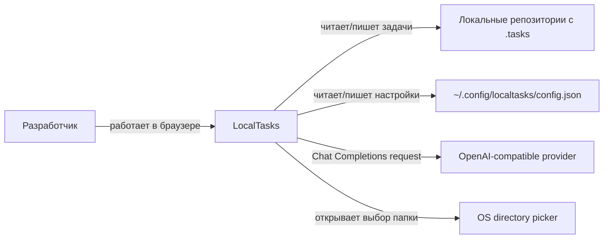
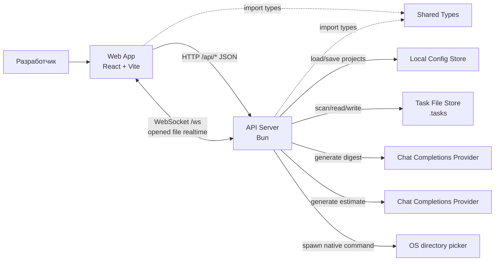

# C4 Model

## L1: System Context

LocalTasks — локальное приложение для разработчика, который ведет задачи в файловой структуре своих репозиториев.

- Пользователь: разработчик, работающий с локальными репозиториями и папками `.tasks`.
- LocalTasks: показывает проекты, строит kanban-доску, открывает и редактирует markdown/text-файлы карточек, realtime-обновляет открытый файл при внешних изменениях, создает задачи, управляет labels и генерирует AI digest за выбранный период.
- Локальные репозитории: источник и место хранения задач; каждый подключенный проект указывает на конкретный repository path.
- Файловая система пользователя: хранит `.tasks`, `labels.json`, markdown/text-файлы карточек и глобальный конфиг приложения.
- OpenAI-compatible provider: внешний Chat Completions API, используемый backend-ом для генерации digest и Scrum Poker estimate через `OPENAI_API_KEY` и `OPENAI_API_BASE_URL`.
- OS directory picker: используется backend-ом при выборе нового проекта через системный диалог.

## L2: Container

- Web App (`src`): React-приложение, запущенное через Vite. Отвечает за kanban-интерфейс, выбор проекта, фильтрацию списков, просмотр дерева файлов, markdown-preview, создание задач, управление labels, AI digest modal и WebSocket-подписку на открытый файл.
- API Server (`server/index.ts`): Bun HTTP API и WebSocket endpoint `/ws`. Принимает запросы от Web App, валидирует project id и payload, вызывает доменные модули для конфига, доски, файлов, labels, digest и оценок, а также рассылает realtime-события по подпискам.
- Shared Types (`shared/types.ts`): общий TypeScript-контракт между frontend и backend.
- Local Config Store (`~/.config/localtasks/config.json`): JSON-файл со списком проектов, активным проектом, именем task-директории и порядком списков.
- Task File Store (`<repo>/.tasks`): файловое хранилище задач. Корневые `task-*` директории попадают в список `Tasks`, остальные корневые директории становятся отдельными списками, одиночные файлы попадают в `Misc`.
- Chat Completions Provider: OpenAI-compatible endpoint, к которому API Server обращается только с backend-а; модель digest захардкожена как `gpt-oss-120b`.

## L3: Component

### Web App

- `App.tsx`: основной экран приложения; держит состояние конфига, доски, выбранного файла, фильтров, активной карточки, создания задач, labels и AI digest modal.
- `api.ts`: тонкий typed client над `/api/*`; инкапсулирует `fetch`, JSON parsing и ошибки API.
- `useTaskRealtime.ts`: React hook для одного WebSocket connection на активное дерево карточки; отправляет `subscribe:file` / `unsubscribe:file`, тихо reconnect-ится с bounded backoff, повторно подписывается на текущий файл и отбрасывает stale-события не для активного project/card/file.
- `styles.css`: стили интерфейса поверх Tailwind CSS.
- `ReactMarkdown` + `remark-gfm`: рендерят markdown-содержимое файлов карточек.

### API Server

- `server/index.ts`: HTTP routing и orchestration. Основные маршруты:
  - `GET /api/config`, `POST /api/projects`, `POST /api/projects/pick`, `PATCH /api/projects/:id/select`, `DELETE /api/projects/:id`;
  - `GET /api/projects/:id/board`, `POST /api/projects/:id/tasks`;
  - `GET /api/projects/:id/file`, `PUT /api/projects/:id/file`;
  - `GET /api/projects/:id/labels`, `POST /api/projects/:id/labels`, `PATCH /api/projects/:id/card-labels`;
  - `POST /api/projects/:id/digest/preview`, `POST /api/projects/:id/digest`;
  - `POST /api/projects/:id/estimate`.
- `server/realtime.ts`: WebSocket realtime service. Валидирует `subscribe:file` / `unsubscribe:file`, держит registry подписок, создает один `chokidar` watcher на активный project task root, debounce-ит filesystem events, фильтрует изменения по точному `fileRelativePath` и отправляет `connection:ready`, `file:updated`, `file:deleted`, `subscription:error`.
- `server/config.ts`: загрузка, нормализация и сохранение глобального конфига; добавление/удаление/выбор проектов; системный выбор директории.
- `server/board.ts`: построение `ProjectBoard` из `.tasks`; чтение и запись файлов; создание task-директорий; защита от выхода за пределы task root.
- `server/labels.ts`: чтение `labels.json`, создание labels, привязка labels через markdown frontmatter, разрешение label ids в объекты.
- `server/digest.ts`: выбирает карточки по `card.updatedAt` в локальной timezone, собирает digest-файлы, строит prompt и вызывает Chat Completions.
- `server/estimate.ts`: реализует Scrum Poker flow: проверка eligibility, чтение контекста задачи, параллельные role-based запросы к LLM, валидация голосов, расчет median/average и запись `estimate.json`.
- `server/ai/openai.ts`: создает OpenAI SDK client с `OPENAI_API_KEY`, `OPENAI_API_BASE_URL` и моделью `gpt-oss-120b`.
- `shared/types.ts`: доменные типы `AppConfig`, `ProjectConfig`, `ProjectBoard`, `BoardList`, `BoardCard`, `FileTreeNode`, `BoardLabel`, `DigestCardPreview`, payload/response-типы API и realtime protocol types.

### Data Flow

- При старте Web App запрашивает `/api/config`, выбирает активный проект и загружает `/api/projects/:id/board`.
- Backend читает конфиг, находит проект, сканирует `<repo>/.tasks`, собирает списки, карточки, дерево файлов, timestamps и labels.
- При открытии файла Web App вызывает `/api/projects/:id/file?path=...`; backend читает файл внутри task root и возвращает markdown или text.
- Пока в card modal выбран файл, Web App открывает `/ws` и подписывается сообщением `subscribe:file` с `projectId`, `cardRelativePath`, `fileRelativePath`. Если файл сменился, модалка закрылась или компонент размонтирован, frontend отправляет `unsubscribe:file` и больше не получает обновления для старого файла.
- Backend принимает WebSocket connection, сразу отправляет `connection:ready`, валидирует project/card/file и запускает watcher только для project task root с активными подписками. Watcher events debounce-ятся и рассылаются только подписчикам точного `fileRelativePath`; изменения других файлов не обновляют открытый preview.
- При успешном внешнем изменении файла backend отправляет `file:updated` с `FileContentResponse` и свежим `BoardResponse`. В WebSocket payload не передаются raw absolute filesystem paths; root metadata в board payload sanitized для realtime-сообщений.
- В reading mode UI сразу заменяет preview payload и board state. В edit mode UI не перезаписывает несохраненный editor text, сохраняет свежий disk payload и показывает предупреждение `File changed on disk` с действием `Reload from disk`.
- Если подписанный файл удален или стал нечитаемым, backend отправляет `file:deleted` с `board` когда board удалось пересобрать, иначе с `board: null`; frontend показывает file-level error pane с относительным путем.
- Если card/file не открыт, active subscription отсутствует: WebSocket hook не отправляет file subscription, и пользователь не видит realtime-specific empty state или connection-status chrome.
- При изменении файла или labels backend пишет изменения в `.tasks`, затем пересобирает board и возвращает свежую модель UI.
- При открытии AI digest modal Web App вызывает `/api/projects/:id/digest/preview`; backend выбирает карточки по локальному inclusive date range и возвращает список задач и файлов, которые войдут в digest.
- При генерации digest Web App вызывает `/api/projects/:id/digest`; backend читает выбранные файлы внутри task root, для `task-*` карточек исключает `draft.md` и отправляет в Chat Completions только `plan.md` и `implementation_progress.md`, а для остальных карточек отправляет все поддерживаемые text/markdown-файлы.
- Digest возвращается как markdown в modal и не сохраняется обратно в `.tasks`.
- При генерации оценки: пользователь в карточке нажимает action `Generate estimate` / `Regenerate estimate`, Web App вызывает `POST /api/projects/:id/estimate` с `cardRelativePath`.
- Backend проверяет `board`-метаданные карточки и eligibility, читает `draft.md`, `plan.md` и optional `implementation_progress.md`, запускает participant-запросы через OpenAI с `Promise.allSettled`, фильтрует валидные голоса и сохраняет `estimate.json` только при >=3 валидных результатов.
- Для успешного ответа backend возвращает `TaskEstimate` и свежий `board`; UI обновляет активную карточку и показывает бейдж `N pts` + decision log без reload.
- При неуспешной генерации (например, <3 валидных голосов) предыдущая оценка сохраняется, а `estimate.json` не перезаписывается.
