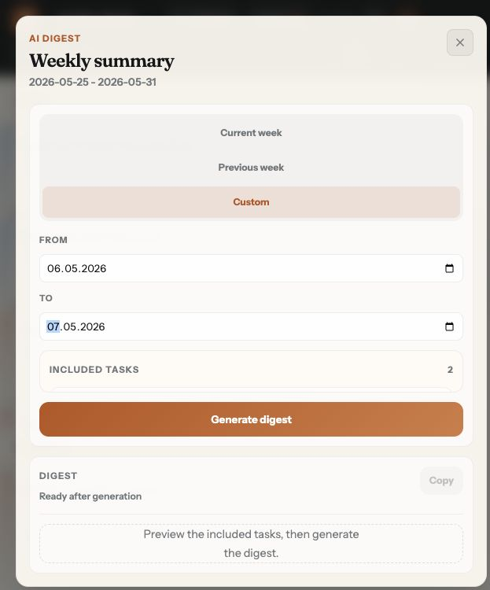
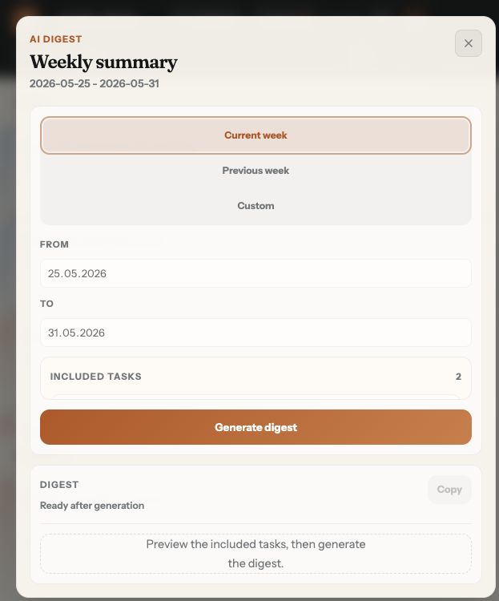
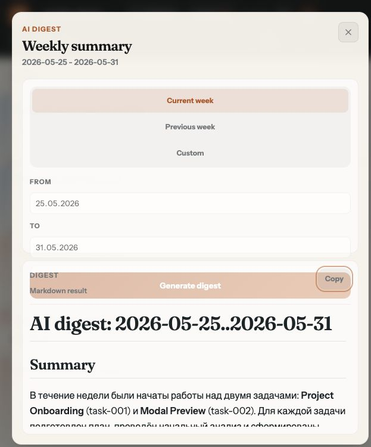

# Dogfood Report: LocalTasks AI Digest

| Field | Value |
|-------|-------|
| **Date** | 2026-05-31 |
| **App URL** | http://127.0.0.1:5174/ |
| **Session** | AI digest QA |
| **Scope** | User Story 06: Generate AI digest |

## Summary

| Severity | Count |
|----------|-------|
| Critical | 0 |
| High | 0 |
| Medium | 2 |
| Low | 1 |
| **Total** | **3** |

## Passed Checks

- AI Digest button is visible and enabled for an active project with `.tasks`.
- Current week defaults to `2026-05-25..2026-05-31` and previews 2 updated tasks.
- Previous week switches to `2026-05-18..2026-05-24` and previews 3 updated tasks.
- Preview includes only `plan.md` and `implementation_progress.md` for `task-*` folders.
- Generate digest successfully calls the backend and renders markdown result.
- Closing the modal returns to the board.

## Issues

### ISSUE-001: Custom date fields do not refresh the digest period or preview

| Field | Value |
|-------|-------|
| **Severity** | medium |
| **Category** | functional |
| **URL** | http://127.0.0.1:5174/ |
| **Repro Video** | N/A |

**Description**

After switching to `Custom` and entering `2026-05-06..2026-05-07`, the date inputs show the custom values, but the modal header and included tasks remain on `2026-05-25..2026-05-31`. Expected: the header should show the custom range, preview should refetch, and the empty state should appear for this range.

**Repro Steps**

1. Open AI Digest on the `smoke-check` project.
   

2. Click `Custom`, enter `2026-05-06` in `From` and `2026-05-07` in `To`.
   

3. Observe that the inputs changed, but the header still says `2026-05-25 - 2026-05-31` and the preview still shows the 2 current-week tasks.

---

### ISSUE-002: Generate button overlaps the digest result on narrow viewport

| Field | Value |
|-------|-------|
| **Severity** | medium |
| **Category** | visual |
| **URL** | http://127.0.0.1:5174/ |
| **Repro Video** | N/A |

**Description**

After digest generation, the orange `Generate digest` button visually overlaps the result header area containing `Digest`, `Markdown result`, and `Copy`. Expected: the action area and digest result should remain separate, with no overlapping controls or text.

**Repro Steps**

1. Open AI Digest with the current-week preview.
   

2. Click `Generate digest` and wait for the markdown result.
   

3. Observe that the generate button is rendered over the result header, making the result area feel broken and harder to use.

---

### ISSUE-003: Copy action gives no success feedback and clipboard remains empty in browser session

| Field | Value |
|-------|-------|
| **Severity** | low |
| **Category** | ux |
| **URL** | http://127.0.0.1:5174/ |
| **Repro Video** | N/A |

**Description**

After clicking `Copy`, the button remains labeled `Copy` instead of changing to `Copied`. The browser clipboard API also returned an empty string in the test session. Expected: the copied state should be visibly confirmed, or an error should be shown if clipboard write failed.

**Repro Steps**

1. Generate a digest successfully.
   

2. Click `Copy`.
   

3. Observe that the button remains `Copy` and no success or error feedback is shown.

