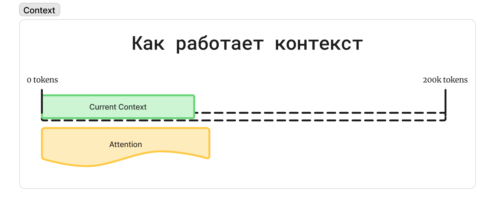
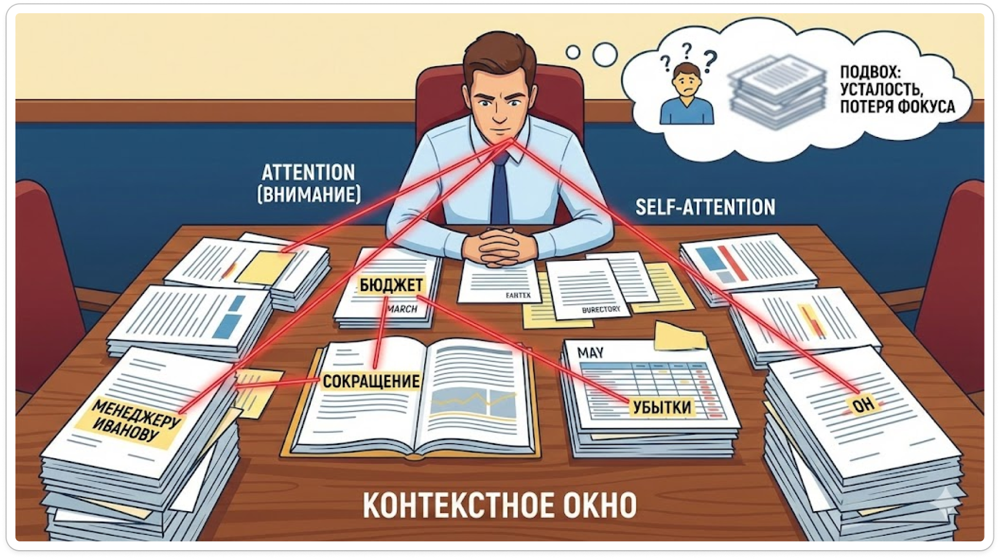
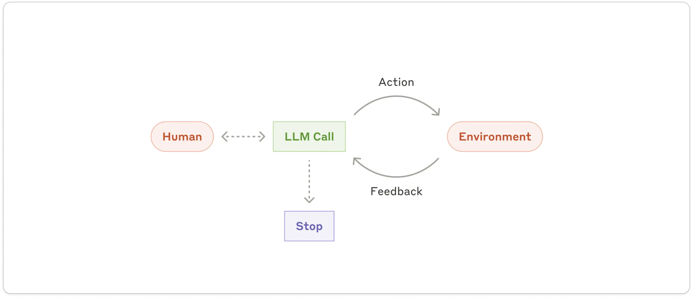
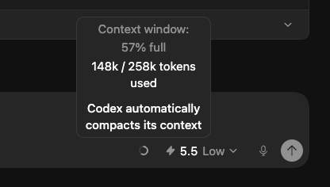
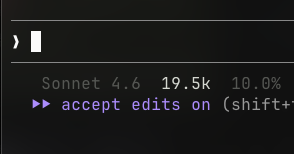

# Контекст и Feedback Loop

## AI Coding

Урок 2

---
## layout: section
# 1. Контекст
---

# Частые проблемы в AI Coding

<v-clicks>

- Агент **галлюцинирует**
- **Забывает** начало задачи
- Игнорирует **правила проекта**
- **Придумывает** то, чего не существует

</v-clicks>

<!--
- *слайд*
- Эти проблемы связаны с плохим контекстом в llm
-->

---

# LLM не хранит ваш проект

Проектные знания живут 
в контексте

не в памяти модели

<!--
- Дело в LLM — stateless система: она не хранит знания о проекте между запросами.
- Знания, полученные во время обучения, зафиксированы в модели на момент релиза.
- После обучения модель не получает новые знания о мире сама по себе.
- Новые знания можно передать только через контекст.
- Плюс: мы контролируем, какие знания о проекте передать модели.
- Минус: за эти знания приходится платить токенами и вниманием модели.
-->

---

# Контекстное окно

  

<!--
- Контекстное окно — предел информации, которую модель может обработать за один раз.
- Оно измеряется в токенах: кусочках слов или символов.
- Ранние модели (GPT-2) держали примерно 2 000-4 000 токенов. 
- 1 слово на англ это 3-5 токенов
- Современные модели могут держать до 2 000 000+ токенов, но чаще всего это 200к
- Если контекст переполнен, старая информация начинает обрезаться.
- В результате модель может потерять то, что было в начале задачи.
-->

---

# Что лежит в контексте типичного Coding Agent

<ul class="mt-10 space-y-3 text-3xl font-bold leading-tight">
  <li v-click>Инструкции</li>
  <li v-click>Инструменты</li>
  <li v-click>История переписки</li>
  <li v-click>Файлы</li>
  <li v-click>Результаты действий</li>
</ul>

<!--
- В агенте контекст не пустой еще до пользовательского запроса.
- В него уже входят системные инструкции, инструкции по проекту, описания tools и MCP.
- Также там лежат история диалога и результаты действий агента.
- Каждый вызов инструмента добавляет в контекст новую инфу.
- Чем больше лишнего попало в контекст, тем сильнее оно конкурирует с важной информацией.
-->

---
layout: image-right
image: /imgs/context3.png
backgroundSize: contain
---

# Контекст уже занят

<v-clicks>

- До твоего запроса уже есть **слои**
- Каждый tool call добавляет **след**
- Лишнее начинает **конкурировать** с важным

</v-clicks>

<!--
- Контекст на практике состоит из нескольких слоев.
- System prompt: базовая инструкция для модели.
- История диалога: предыдущие вопросы и ответы.
- И User prompt: текущий запрос пользователя.
- Все эти слои занимают контекстное окно.
-->

---

# Контекстное окно ≠ внимание

  

<!--
- Современные LLM основаны на архитектуре Transformer.
- Важный механизм Transformer — self-attention.
- Модель разбивает текст на токены и вычисляет связи между ними.
- Контекстное окно — это то, что модель видит.
- Attention — это то, на что модель реально обращает внимание.
- Если в контексте слишком много важной информации, она не может быть воспринята одинаково приоритетно.
- Часть информации получает высокий приоритет, часть — низкий.
- Поэтому модель может проигнорировать правила, архитектуру или часть требований.
-->

---

# Context engineering

Следить за тем, 
что попадает в контекст

<v-clicks>

- Что агент **уже знает** о системе?
- Что агент **должен знать**?
- Чего агент **знать не должен**?

</v-clicks>

<!--
И вся суть контекста инжиниринга сводится к тому, чтобы следить за тем, что попадает в контекст.

Вы, как инженер, должны понимать, а что именно агент знает уже о моей системе, что он должен знать и чего он знать не должен. Это поможет агенту решать задачу.
-->

---

# LLM, агент, harness

  

    
LLM

    
Large Language Model

    
большая языковая модель

  

  

    
Agent

    
LLM + loop

    
агент: модель в цикле действий

  

  

    
Harness

    
runtime + tools

    
обвязка агента

  

  

<!--
- LLM — сама нейросеть: на вход получает токены, на выходе выдает текст.
- Агент — loop вокруг LLM.
- Агент получает информацию, выполняет действия и возвращает результат.
- Окружение выполняет действия агента: код, рантайм, файловая система, инструменты.
- Harness — более широкая система вокруг агента.
- В harness входят MCP-серверы, skills, tools, AGENTS.md, CLAUDE.md, compaction и другие практики работы с контекстом.
-->

---

# Garbage in, garbage out

  

    Нерелевантный контекст
  

  

    Устаревшие знания
  

  

    Лишние файлы
  

  

    Неактуальные правила
  

Модель начинает угадывать, что важно.

<!--
- Как решать проблемы с контекстом?
- Ключевое правило: garbage in, garbage out.
- Если в контексте нерелевантная информация, модели приходится угадывать, что важно.
- Чем больше неактуальной информации, тем хуже результат.
- Не нужно насильно подмешивать в контекст все подряд.
- Сильные модели и хорошие harness лучше собирают контекст сами.
- В более слабых моделях и harness правильный сбор контекста все еще остается отдельной задачей.
- Существует техника context engineering.
-->

---

# Как это работает на практике?

Смотрим не только 
на ответ агента

<v-clicks>

- **Ход задачи:** что агент пишет и как рассуждает
- **Файлы:** что он читает и запрашивает
- **Инструменты:** какие skills и tools дергает
- **Карта системы:** что сложилось у него в голове

</v-clicks>

Так мы понимаем, какой контекст реально попал агенту.

<!--
На практике мы должны понимать, какая именно информация попадает агенту в контекст.

Для этого нужно читать, что агент пишет о ходе задачи: что у него происходит, что он видит, о чем он думает.

Также нужно смотреть, какие файлы он запрашивает, какие скиллы он дергает.

Это позволяет понимать, какая карта в голове сложилась у агента.
-->

---

# Откуда агент это знает?

Если источник неясен — 
спроси

<v-clicks>

- Откуда ты это знаешь?
- В каких **инструкциях** это было?
- Через какие **файлы или tools** ты к этому пришел?
- Почему эта информация вообще оказалась в контексте?

</v-clicks>

Нашли источник — можем исправить проблему.

<!--
Если мы пропустили или не поняли, откуда агент нашел какую-то информацию, мы можем задать ему вопрос.

Можно спросить напрямую или окольными путями: откуда он знает об этой информации, в каких именно инструкциях эта информация находилась.

Это позволит понять, как именно агент добрался до этой информации и почему она вообще там находится.

После этого можно исправить проблему.
-->

---

# Заполняемость контекста

  

    
Codex

    
  

  

    
Claude Code

    
  

<v-clicks>

- Отслеживать, сколько **контекстного окна** использовано
- При проблемах смотреть на **80-90%**
- После нескольких **compaction** лучше пересобрать контекст

</v-clicks>

<!--
Также мы должны понимать, насколько много контекста сейчас заполнено.

В Codex есть показатель, который отображает, сколько контекста использовано.

В Claude Code есть statusline, и туда можно вывести текущую заполненность контекста.

В других агентах такой инструмент тоже обязательно должен быть.

Важно отслеживать этот показатель. Когда агент начинает тупить, галлюцинировать или забывать, что было в начале, нужно посмотреть, насколько заполнен контекст.

Скорее всего, вы увидите, что он заполнен больше чем на 80-90%, либо уже было несколько compaction.

После этого стоит следить за текущим контекстом и стараться не превышать заполненность больше чем на 80-90%.
-->

---

# Техническое демо

Посмотрим, 
как контекст выглядит 
в LLM API

<v-clicks>

- сообщения
- роли
- история
- ответ модели

</v-clicks>

<!--
- Здесь переходим от теории контекста к техническому демо.
- Показываем, как работа с контекстом выглядит на уровне LLM API.
- В демо важно обратить внимание на сообщения, роли, историю и ответ модели.
-->

---
layout: section
---

# Feedback loop

---

# Проблема: агент не видит UI

<v-clicks>

- Мы просим: **поправь этот элемент**
- Агент видит только **код**
- Как выглядит интерфейс, он только **представляет**
- Представляет — **плохо**
- Значит, ему нужен **браузер**

</v-clicks>

<!--
- Частая проблема – при работе с UI.
- Просим агента обновить один элемент, потом другой.
- Ожидаем, что агент поймет, что компонент некрасиво расположен относительно другого компонента.
- Но AI-агент не понимает
- Он не может просто взглянуть на интерфейс.
- Он видит только код и может только представить, как это выглядит.
- Представляет он это очень плохо.
- Поэтому нужен инструмент который позволит агенту увидеть результат
-->

---

# Решение – Feedback Loop

Информация → действие → результат → коррекция

<v-clicks>

- Агент понимает, что **не хватает информации**
- **Добирает** ее через инструменты
- Выполняет **действие**
- Смотрит на **результат**
- **Корректирует** решение

</v-clicks>

Loop работает только если агент может увидеть последствия своих действий.

<!--
- Feedback loop — это механизм, в котором у LLM есть возможность добрать необходимый контекст.
-->

---

# Зачем он нужен

Без проверки 
код остается гипотезой

<v-clicks>

- Полная документация **не гарантирует** рабочий код
- Агенту нужно увидеть **результат действия**
- Feedback loop превращает догадку в **проверку**

</v-clicks>

Писать без запуска — как программировать на листочке.

<!--
- Для успешного выполнения задач feedback loop необходим.
- Без feedback loop надеяться, что агент напишет нормальный рабочий код
  с первого или второго раза, глупо.
- Даже полная документация перед глазами не гарантирует, что агент
  напишет код с первого раза.
- Feedback loop должен дать агенту возможность проверить свою задачу
  и своё решение.
- Аналогия: программировать без проверки — как писать код на листочке
  или в блокноте без возможности запустить его.
- Пока мы не загрузим код в компилятор, мы не узнаем результат.
- Для агента это работает так же.
-->

---
## layout: section
# 6. Feedback loop для разных задач
---

# Визуальная правка UI

UI нужно 
увидеть

<v-clicks>

- Иногда достаточно **скриншота**
- Иногда нужен **браузер**
- После правки агент должен увидеть **результат**

</v-clicks>

Код не показывает расстояния, ритм и визуальный баланс.

<!--
- Самый очевидный feedback loop - это работа с UI
- Иногда агенту достаточно увидеть скриншот.
- А иногда - дать доступ к браузеру
-->

---

# Функциональность, анимации, клики

Нужен **браузер**. Варианты подключения и конкретные инструменты:

  

    <carbon-bot class="text-2xl text-emerald-500" />
    
headless

  

  
Agent Browser

  <a href="https://agent-browser.dev/" target="_blank" class="text-xs opacity-70 break-all">agent-browser.dev</a>

  

    <logos-chrome class="text-2xl" />
    
standalone / CDP

  

  
Chrome DevTools

  <a href="https://github.com/ChromeDevTools/chrome-devtools-mcp" target="_blank" class="text-xs opacity-70 break-all">github.com/ChromeDevTools/chrome-devtools-mcp</a>

  

    <mdi-puzzle-outline class="text-2xl text-violet-500" />
    
расширение

  

  
Playwriter

  <a href="https://github.com/remorses/playwriter" target="_blank" class="text-xs opacity-70 break-all">github.com/remorses/playwriter</a>

<!--
- Если речь про функционал, анимации, процессы или клики, нужно точно подключать браузер.
- Иногда достаточно headless-браузера — например, Agent Browser.
- Chrome DevTools MCP — в первую очередь запускается как standalone, плюс умеет подключаться к существующему Chrome в debug mode по CDP.
- Иногда нужно расшарить агенту сессию своего браузера.
- установить расширение (Playwriter), чтобы агент подключался к существующему браузеру.
- Всё зависит от задачи и того, чего будет достаточно.
-->

---
layout: image-right
image: /imgs/performance-tab.png
backgroundSize: contain
---

# Сложные визуальные баги

<v-clicks>

- Скриншота может быть **недостаточно**
- Может понадобиться **видео**
- Модели **не воспринимают** видео — используем **профайлинг**
- Записать сессию профайлинга, сохранить файл и **передать агенту**

</v-clicks>

<!--
- Если нужно проверить анимацию или баг, который сложно заскриншотить,
  может понадобиться видео.
- Текущие модели OpenAI и Anthropic видео не воспринимают.
- Для таких случаев можно использовать профайлинг.
- Профайлинг записывает операции, которые происходили во время сессии профилирования.
- В профиле должны быть видны изменения анимаций, моргания интерфейсов и компонентов.
- Можно записать сессию, сохранить файл и передать агенту.
-->

---

# Главное правило

Правильный feedback 
+ правильный контекст

<v-clicks>

- Закрывает **99% задач**
- Если агент снова ошибается — проверяем **feedback loop**
- Потом проверяем, полезный ли у него **контекст**

</v-clicks>

<!--
- Самое главное в решении любой задачи — обеспечить агента feedback и правильным контекстом.
- Если это сделано, можно выполнить 99% задач.
- Если агент снова и снова сталкивается с ошибками, и его приходится постоянно подпинывать, это сигнал.
- Нужно разобраться, эффективно ли работает feedback loop у агента.
- Также нужно проверить, полезный ли у него контекст.
- Если нет — нужно погрузиться в это и разобраться.
-->

---

# Минимальная достаточность

Feedback loop 
под конкретный кейс

Задача инженера — дать агенту минимально достаточный способ оценить результат.

<v-clicks>

- **Визуал:** скриншот, браузер, сессия пользователя
- **Динамика:** профайлинг, браузер агента
- **Система:** логи сервера, доступ к VPS
- **Интеграции:** CLI / MCP внешнего сервиса

</v-clicks>

<!--
- Поэтому, у нас как у инженеров есть задача: создать и придумать feedback loop под наш кейс.
- Нужно понимать минимальную достаточность проверки.
- понять, что будет необходимо, чтобы агент оценил результат.
- как агент сможет убедиться, что выполнил задачу хорошо.
-->

---

# Самый очевидный feedback loop

Базовая проверка 
в AI Coding

<v-clicks>

- **Линтеры**
- **Тайпчеки**
- **Тесты**

</v-clicks>

<!--
- Самый очевидный feedback loop в AI coding — это линтеры, тайпчеки и тесты.
- Это базовый способ дать агенту понять, сломал он что-то или нет.
- Агент должен не просто написать код, а получить сигнал от системы.
- Поэтому эти проверки нужно запускать и использовать как обратную связь.
-->

---

# Техническое демо

Посмотрим, 
как feedback loop работает 
под капотом

Переходим к демо agent loop.

<!--
- Здесь переходим к техническому демо feedback loop.
- Слайд нужен как короткий мостик к демо.
- Дальше показываем, как agent loop работает под капотом.
-->
