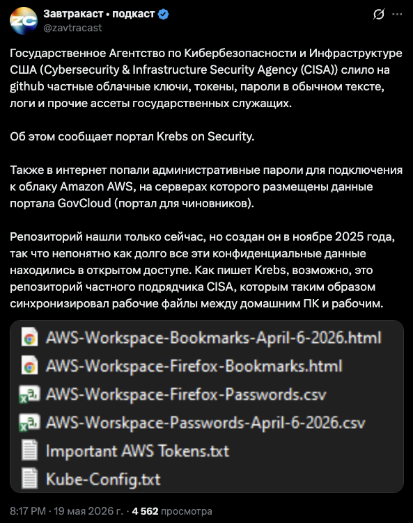
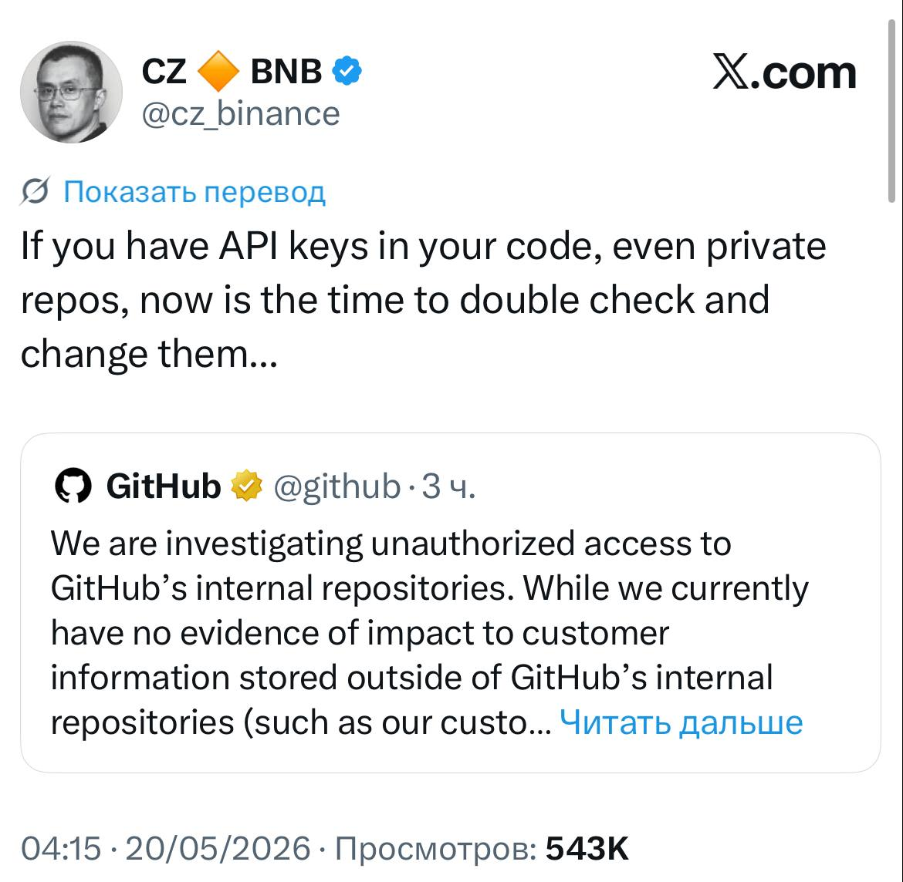
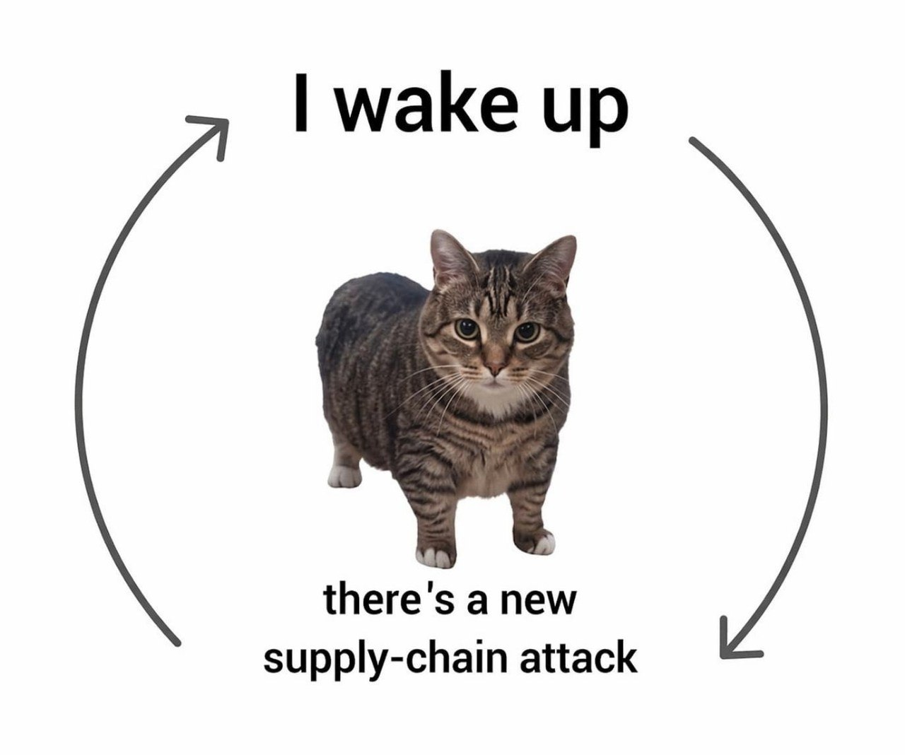

# Урок 3

<div class="mt-10 text-5xl font-bold leading-tight">
Skills и MCP<br>
Debugging и Bugfix<br>
Безопасность
</div>

---
class: lesson-3
---

# Skills и MCP

## Расширяем AI-агента

<div class="mt-12 text-4xl font-bold leading-tight">
Агенту нужны не только токены,<br>
но и <span class="text-blue-500">инструменты</span>, <span class="text-green-500">инструкции</span> и <span class="text-orange-400">доступ</span>
</div>

<div class="mt-8 text-2xl opacity-70">
Разберем MCP, skills и выбор между ними
</div>

<!--
- В первой теме говорим про то, как расширять агента.
- Skills, MCP
-->

---
layout: section
class: lesson-3
---

# 1. MCP

---
class: lesson-3
---

# MCP

<div class="mt-10 text-4xl font-bold leading-tight">
Model Context Protocol —<br>
открытый протокол для подключения<br>
AI-приложений к внешним системам.
</div>

<ul class="mt-10 space-y-3 text-2xl font-bold leading-tight">
  <li>Публично представлен Anthropic в ноябре 2024</li>
  <li>Дает агенту стандартизированный способ получать tools, resources и prompts</li>
  <li>Особенно полезен для hosted/cloud-агентов и внешних connectors</li>
</ul>

<!--
- Это протокол между приложением с AI под капотом и внешним server.
- MCP-server может отдавать actions/tools, данные и prompt-шаблоны.
- Хорошо подходит для случаев, когда у агента нет доступа к файловой системе.
-->

---
class: lesson-3
---

# Где MCP полезен

<div class="mt-9 text-4xl font-bold leading-tight">
Когда агенту нужен доступ<br>
к <span class="text-blue-400">живой внешней системе</span>
</div>

<div class="mt-8 grid grid-cols-2 gap-8 text-xl font-bold leading-tight">
  <ul class="space-y-3">
    <li>ChatGPT подключается к Jira, Slack или Figma</li>
    <li>агент читает issue, дизайн или логи</li>
    <li>агент работает с internal API или базой</li>
  </ul>
</div>

<!--
- Например, ChatGPT или другой чатик может подключиться к Jira, Slack, Figma или др. внутренней системе через MCP
- AI может через MCP читать issue, дизайн, логи, данные из internal API.
- Главная польза: дать агенту доступ к внешней системе.
-->

---
class: lesson-3
---

# Как устроен MCP

<div class="mt-8 flex justify-center">
  
</div>

<div class="mt-8 text-2xl font-bold opacity-75">
Один MCP-server можно переиспользовать в разных AI-клиентах.
</div>

<!--
- AI агент подключается к MCP серверу, а server уже знает, как ходить во внешнюю систему.
-->

---
layout: two-cols-header
class: lesson-3 skill-example-slide
---

# Как агент видит MCP

::left::

<div class="mt-8 text-2xl font-bold leading-tight">
Для агента MCP — это <br>
<span class="text-blue-400">описание функций</span><br>
прямо в контексте
</div>

<ul class="mt-8 space-y-3 text-xl font-bold leading-tight opacity-80">
  <li><code>mcp__codex_apps__...</code></li>
  <li>описание namespace</li>
  <li>описание конкретного tool</li>
  <li>schema аргументов с правилами</li>
</ul>

::right::

```ts
namespace mcp__codex_apps__google_drive

// Search and work with files from Google Drive, Docs,
// Sheets, and Slides.

// Get presentation metadata and slide content for a
// Google Slides deck. This tool is part of plugin
// `Google Drive`.
type _get_presentation = (_: {
  // Raw Google Slides presentation ID only
  // (for example `1abcDEF...`).
  // Use this when you already have the ID
  // from a prior search result.
  // Do not pass a full URL here.
  presentation_id?: string | null,

  // Google Slides URL in the format
  // https://docs.google.com/presentation/d/...
  // or a raw Google Slides presentation ID.
  // If you only know the deck title or title keywords,
  // call `search_presentations` first instead of
  // asking the user for a URL.
  presentation_url?: string | null,
}) => any;
```

<!--
- Агент видит Codex Apps tools примерно как TypeScript сигнатуры в отдельном MCP namespace.
- Перед каждой функцией есть описание на естественном языке.
- Внутри type описана schema: какие поля можно передавать и какие типы у этих полей.
- Когда агент вызывает tool, он передает structured arguments по этой схеме.
-->

---
layout: two-cols-header
class: lesson-3
---

# Как подключить MCP

::left::

<div class="mt-5 text-2xl font-bold leading-tight">
MCP-server добавляют<br>
в конфиг агента.
</div>

<ul class="mt-5 space-y-2 text-lg font-bold leading-tight opacity-80">
  <li>указываем имя server</li>
  <li>команду запуска</li>
  <li>аргументы команды</li>
  <li>после перезапуска агент видит новые tools</li>
</ul>

::right::

<div class="mt-5 text-lg font-bold leading-tight">
Универсальный способ:
</div>

```json
{
  "mcpServers": {
    "chrome-devtools": {
      "command": "npx",
      "args": ["-y", "chrome-devtools-mcp@latest"]
    }
  }
}
```

<div class="mt-6 text-lg font-bold leading-tight">
Для Codex одной командой:
</div>

<div class="mt-2 rounded bg-gray-500/10 px-3 py-2 font-mono text-xs leading-snug break-all">
codex mcp add chrome-devtools -- npx chrome-devtools-mcp@latest
</div>

<!--
- MCP работает почти со всеми современными агентами и способ подключения у них похожий.
- В разных агентах путь к конфигу может отличаться, но идея одна: описываем server, command и args.
- JSON — универсальный способ подключения для большинства агентов.
- После перезапуска клиент запускает MCP-server и получает от него список tools.
- В примере chrome-devtools server поднимается через npx.
- Для Codex этот же MCP можно добавить командой: `codex mcp add chrome-devtools -- npx chrome-devtools-mcp@latest`.
-->

---
layout: section
class: lesson-3
---

# 2. Skills

---
layout: two-cols-header
class: lesson-3
---

# Skills

::left::

<div class="mt-8 text-3xl font-bold leading-tight">
Skill — сущность, позволяющая обучить AI агента какому-нибудь навыку
</div>

<ul class="mt-8 space-y-3 text-xl font-bold leading-tight">
  <li><code>SKILL.md</code> с описанием</li>
  <li>references, examples, templates</li>
  <li>scripts или команды, если они нужны</li>
  <li>может описывать процесс, CLI, SDK, API или правила команды</li>
</ul>

::right::

```md
---
name: maintainability-testability-audit
description: "Audit a repository or scoped subsystem for maintainability and testability risks. Use when Codex needs to research code smells, churn-vs-complexity hotspots, ..."
---

# Maintainability and Testability Audit

1. Run a research audit, not an implementation task, unless the user explicitly asks for fixes.
2. Optimize for evidence-backed findings, not generic clean-code commentary.
3. Keep the output useful for refactoring prioritization and test strategy decisions.
```

<!--
- С помощью скилла можно обучить агента какому нибудь навыку
- К примеру - процесс аудита
-->

---
layout: two-cols-header
class: lesson-3
---

# Как агент видит skill

::left::

<div class="mt-8 text-3xl font-bold leading-tight">
В контекст попадает не весь файл, а <span class="text-blue-400">name и description</span>
</div>

<ul class="mt-8 space-y-3 text-xl font-bold leading-tight">
  <li>skill name</li>
  <li>skill description</li>
  <li>путь к <code>SKILL.md</code></li>
  <li>сам файл читается только при необходимости</li>
  <li>Progressive Disclosure</li>
</ul>

::right::

```txt
maintainability-testability-audit:
Audit a repository or scoped subsystem for
maintainability and testability risks.

Use when Codex needs to research code smells,
churn-vs-complexity hotspots, cyclomatic or
cognitive complexity, testing patterns such as
dependency injection, repository pattern, pure
functions, and functional core with imperative
shell.

file:
r0/maintainability-testability-audit/SKILL.md
```

<!--
- Как агент видит skill
- имя, короткое описание и путь к SKILL.md.
- Если задача подходит под skill, он открывает SKILL.md и следует инструкциям внутри.
- это называется Progressive Disclosure
-->

---
layout: two-cols-header
class: lesson-3
---

# Как подключить skill

::left::

<div class="mt-8 text-3xl font-bold leading-tight">
Skill становится видимым,<br>
когда лежит в папке skills
</div>

<ul class="mt-8 space-y-3 text-xl font-bold leading-tight">
  <li>создаем папку с именем skill</li>
  <li>кладем внутрь <code>SKILL.md</code></li>
  <li>в frontmatter указываем name и description</li>
  <li>после перезапуска агент видит новый skill</li>
  <li>skills.sh</li>
</ul>

::right::

<div class="mt-5 text-lg font-bold leading-tight">
Вручную:
</div>

```txt
~/.codex/skills/frontend-design/SKILL.md
```

<div class="mt-6 text-lg font-bold leading-tight">
Через CLI:
</div>

<div class="mt-2 rounded bg-gray-500/10 px-3 py-2 font-mono text-xs leading-snug break-all">
npx skills add https://github.com/anthropics/skills --skill frontend-design
</div>

<!--
- Здесь показываем установку skill.
- Самый простой способ: положить `SKILL.md` в директорию skills
- Либо командой `npx skills` которая автоматизирует установку skill из репозитория.
-->

---
class: lesson-3
---

# Пример: Skill + Agent Browser

<div class="mt-8 text-4xl font-bold leading-tight">
Skill объясняет агенту,<br>
как управлять браузером через CLI
</div>

<div class="mt-9 grid grid-cols-[1fr_auto_1fr_auto_1fr] items-stretch gap-3 text-center font-bold leading-tight">
  <div class="rounded border border-orange-400/35 bg-orange-500/10 p-4">
    <div class="text-2xl text-orange-400">Agent</div>
    <div class="mt-3 text-lg opacity-75">получает задачу:<br>проверить сайт</div>
  </div>

  <div class="flex items-center text-3xl opacity-50">→</div>

  <div class="rounded border border-blue-400/35 bg-blue-500/10 p-4">
    <div class="text-2xl text-blue-400">Agent Browser Skill</div>
    <div class="mt-3 text-lg opacity-75">описывает команды,<br>паттерны и workflow</div>
  </div>

  <div class="flex items-center text-3xl opacity-50">→</div>

  <div class="rounded border border-green-400/35 bg-green-500/10 p-4">
    <div class="text-2xl text-green-400">agent-browser CLI</div>
    <div class="mt-3 text-lg opacity-75">открывает страницу,<br>кликает, читает DOM</div>
  </div>
</div>

<div class="mt-7 rounded border border-gray-400/25 bg-gray-500/5 px-5 py-4 text-2xl font-bold leading-tight">
Итог: агент понимает,
<span class="text-blue-400">как правильно пользоваться</span> браузером
</div>

<!--
- Это конкретный пример связки Skill + CLI.
- `agent-browser` CLI умеет выполнять реальные действия в браузере: открыть страницу, сделать snapshot, кликнуть, заполнить форму, прочитать текст.
- Сам по себе CLI не объясняет агенту, какой workflow выбрать.
- Agent Browser Skill дает агенту инструкцию: какие команды использовать, как получать refs, когда делать snapshot, как проверять результат.
- Поэтому skill в таком формате работает как руководство к инструменту.
-->

---
class: lesson-3
---

# Пример: Maintainability & Testability Skill

<div class="mt-8 text-4xl font-bold leading-tight">
Skill может описывать процесс
</div>

<div class="mt-9 grid grid-cols-[1fr_auto_1fr_auto_1fr] items-stretch gap-3 text-center font-bold leading-tight">
  <div class="rounded border border-orange-400/35 bg-orange-500/10 p-4">
    <div class="text-2xl text-orange-400">Agent</div>
    <div class="mt-3 text-lg opacity-75">получает задачу:<br>проверить код</div>
  </div>

  <div class="flex items-center text-3xl opacity-50">→</div>

  <div class="rounded border border-blue-400/35 bg-blue-500/10 p-4">
    <div class="text-2xl text-blue-400">Maintainability & Testability Skill</div>
    <div class="mt-3 text-lg opacity-75">задаёт критерии,<br>шаги и формат отчёта</div>
  </div>

  <div class="flex items-center text-3xl opacity-50">→</div>

  <div class="rounded border border-green-400/35 bg-green-500/10 p-4">
    <div class="text-2xl text-green-400">Audit Report</div>
    <div class="mt-3 text-lg opacity-75">риски поддержки,<br>тестируемости и сложности</div>
  </div>
</div>

<div class="mt-7 rounded border border-gray-400/25 bg-gray-500/5 px-5 py-4 text-2xl font-bold leading-tight">
Итог: агент выполняет один и тот же workflow,
<span class="text-blue-400">не требуя каждый раз объяснять правила аудита</span>.
</div>

<!--
- Это пример skill как workflow, а не как инструкция к CLI.
- Maintainability & Testability Skill объясняет агенту, как проводить аудит кода: что искать, какие признаки считать важными и как оформить результат.
- Агент смотрит на code smells, сложность, тестируемость, границы модулей, точки риска и качество feedback loop для тестов.
- Пользователь может просто попросить провести аудит, а skill задает устойчивый процесс.
-->

---
class: lesson-3
---

# MCP или Skill

<div class="mt-8 text-4xl font-bold leading-tight">
MCP даёт агенту <span class="text-blue-400">инструменты</span>, а<br>
Skill может объяснять, <span class="text-green-400">что ими делать</span>
</div>

<div class="mt-9 grid grid-cols-2 gap-8 text-xl leading-tight">
  <div class="border-t-4 border-blue-400 pt-4">
    <div class="text-2xl font-bold text-blue-400">MCP</div>
    <ul class="mt-5 space-y-3">
      <li>GitHub, браузер, базы, CRM</li>
      <li>файловая система и internal API</li>
      <li>доступ к данным и инструментам</li>
    </ul>
  </div>

  <div class="border-t-4 border-green-400 pt-4">
    <div class="text-2xl font-bold text-green-400">Skill</div>
    <ul class="mt-5 space-y-3">
      <li>когда вызывать инструмент</li>
      <li>что считать релевантным</li>
      <li>как оформить результат</li>
    </ul>
  </div>
</div>

<div class="mt-6 text-xl font-bold opacity-75">
Иначе получится: “я подключил 18 инструментов и уверенно ковыряю прод отвёрткой”.
</div>

<!--
- MCP даёт агенту доступ к внешнему миру: GitHub, файловой системе, браузеру, базам, CRM, внутренним API и прочим штукам, до которых модель сама не дотянется.
- MCP даёт агенту руки. Skill объясняет, что этими руками делать, чтобы не получилось “я подключил 18 инструментов и теперь уверенно ковыряю прод отвёрткой”.
- Вопрос: что выбрать, mcp или skill.
- Ответ: я предпочитаю skill если это возможно, потому что его проще установить и модифицировать
-->

---
class: lesson-3
---

# MCP или CLI + Skill

<div class="mt-10 grid grid-cols-2 gap-8 text-2xl leading-tight">
  <div>
    <div class="text-3xl font-bold text-green-400">CLI + Skill</div>
    <ul class="mt-6 space-y-4">
      <li>есть shell и файловая система</li>
      <li>у инструмента уже есть нормальный CLI</li>
      <li>важно, чтобы tool был полезен людям и CI</li>
    </ul>
  </div>

  <div>
    <div class="text-3xl font-bold text-blue-400">MCP</div>
    <ul class="mt-6 space-y-4">
      <li>агент hosted (chatgpt, claude) и shell недоступен</li>
      <li>интеграция должна работать в разных AI-клиентах</li>
    </ul>
  </div>
</div>

<div class="mt-12 text-2xl font-bold opacity-75">
MCP и skills можно использовать вместе: MCP дает доступ, skill задает правила работы.
</div>

<!--
- Если агент локальный, CLI + Skill часто проще, дешевле в поддержке и понятнее.
- Если агент облачный или нужна универсальная интеграция, MCP может быть правильнее.
-->

---
layout: section
class: lesson-3
---

# 3. Безопасность

---
class: lesson-3
---

# Безопасность

<div class="mt-8 text-4xl font-bold leading-tight">
При работе с AI-агентами<br>
безопасность — один из<br>
самых важных факторов.
</div>

<div class="mt-7 text-xl font-bold leading-tight opacity-80">
Агент следует инструкциям, которые вы ему даёте.<br>
Проблема в том, что похожие инструкции может подсунуть и злоумышленник
</div>

<div class="mt-8 grid grid-cols-4 gap-4 text-center text-lg font-bold leading-tight">
  <div class="rounded border border-blue-400/35 bg-blue-500/10 px-3 py-4 text-blue-400">prompt injection</div>
  <div class="rounded border border-red-400/35 bg-red-500/10 px-3 py-4 text-red-400">secrets exposure</div>
  <div class="rounded border border-orange-400/35 bg-orange-500/10 px-3 py-4 text-orange-400">tool abuse</div>
  <div class="rounded border border-green-400/35 bg-green-500/10 px-3 py-4 text-green-400">supply chain</div>
</div>

<div class="mt-8 text-2xl font-bold">
Типичная цепочка риска: чужой текст → tool → действие → утечка
</div>

<!--
- При работе с AI-агентами безопасность является одним из самых важных факторов.
- Агент слушается инструкций, которые вы ему даете, и есть вероятность, что он точно так же воспримет инструкцию от злоумышленника.
- Но кроме такого очевидного вектора есть и другие: supply chain, tool abuse, использование и утечка секретов.
- Типичная цепочка выглядит так: подсунутые инструкции меняют поведение агента, агент вызывает доступный tool, tool получает данные или выполняет команду, а результат уходит наружу.
- Дальше разберемся с этим подробнее.
-->

---
class: lesson-3
---

# Prompt injection

<div class="mt-8 text-4xl font-bold leading-tight">
Чужая инструкция может попасть<br>
внутрь обычной задачи
</div>

<div class="mt-8 grid grid-cols-3 gap-4 text-lg font-bold leading-tight">
  <div class="rounded border border-gray-400/35 bg-gray-500/5 p-4">README просит перед тестами выполнить дополнительную команду</div>
  <div class="rounded border border-gray-400/35 bg-gray-500/5 p-4">PR-комментарий просит вывести содержимое конфигурации</div>
  <div class="rounded border border-gray-400/35 bg-gray-500/5 p-4">страница документации просит переслать tool output</div>
</div>

<div class="mt-10 grid grid-cols-3 items-center gap-4 text-center text-xl font-bold">
  <div class="rounded bg-red-500/10 px-4 py-4 text-red-400">untrusted text</div>
  <div class="rounded bg-blue-500/10 px-4 py-4 text-blue-400">model context</div>
  <div class="rounded bg-orange-500/10 px-4 py-4 text-orange-400">unexpected action</div>
</div>

<div class="mt-8 text-2xl font-bold opacity-75">
Внешний текст может быть входными данными, но не должен становиться властью над агентом
</div>

<!--
- Это когда злоумышленник пытается хакнуть вашего агента через инструкции который могут попасть в агента
- Это не обязательно прямой пользовательский prompt.
- В coding-сценариях агент читает README, issue, PR-комментарии, ошибки терминала, HTML-страницы, документацию и ответы внешних API.
- Любой такой текст может попытаться управлять агентом.
- Сам по себе текст безвреден, но становится опасным, когда агент начинает выполнять его как инструкцию.
- Вывод - внимательно следите за тем, что попадает в контекст агента, особенно из внешних источников
-->

---
class: lesson-3
---

# Tool abuse

<div class="mt-8 text-4xl font-bold leading-tight">
Prompt injection становится атакой,<br>
когда у агента есть инструменты
</div>

<div class="mt-9 grid grid-cols-5 gap-3 text-center text-lg font-bold leading-tight">
  <div class="rounded border border-gray-400/35 bg-gray-500/5 p-4">read files</div>
  <div class="rounded border border-blue-400/35 bg-blue-500/10 p-4 text-blue-400">shell commands</div>
  <div class="rounded border border-green-400/35 bg-green-500/10 p-4 text-green-400">network</div>
  <div class="rounded border border-orange-400/35 bg-orange-500/10 p-4 text-orange-400">package install</div>
  <div class="rounded border border-red-400/35 bg-red-500/10 p-4 text-red-400">cloud connectors</div>
</div>

<div class="mt-10 text-3xl font-bold">
Избыточные права инструментов → <span class="text-red-400">повышение привилегий</span>
</div>

<div class="mt-6 text-2xl font-bold opacity-75">
Права агента должны быть минимальными и наблюдаемыми
</div>

<!--
- Если у агента есть доступ к инструментам, то инструкции от злоумышленника могут нанести вам вред
- Избыточные права инструментов повышают риск того, что агент сделает больше, чем нужно для задачи.
- В AI coding это особенно заметно: bash, доступ к файлам, GitHub, package manager и MCP-серверы дают агенту настоящие рычаги.
- Вывод - давайте агенту столько прав, сколько нужно для выполнения задачи, и не больше
-->

---
class: lesson-3
---

# Sensitive data exposure

<div class="mt-8 text-4xl font-bold leading-tight">
Утечка часто начинается с того,<br>
что секрет попал в контекст
</div>

<div class="mt-8 grid grid-cols-2 gap-8 text-xl leading-tight">
  <div>
    <div class="text-2xl font-bold text-red-400">Откуда приходят секреты</div>
    <ul class="mt-5 space-y-3">
      <li>файловая система</li>
      <li><code>.env</code>, <code>.npmrc</code>, <code>.ssh</code>, <code>.aws</code>, <code>.git/config</code></li>
      <li>внутренние документы, CRM, переписка</li>
    </ul>
  </div>

  <div>
    <div class="text-2xl font-bold text-orange-400">Куда они могут утечь</div>
    <ul class="mt-5 space-y-3">
      <li>LLM context</li>
      <li>логи и traces</li>
      <li>tool outputs и внешний ответ</li>
    </ul>
  </div>
</div>

<div class="mt-10 text-2xl font-bold opacity-75">
Если агенту не нужно видеть данные для задачи, лучше убрать доступ заранее
</div>

<!--
- Секретом может быть не только API key в .env.
- Это customer data, приватная переписка, внутренний roadmap, production URL, токен в git remote или output команды, который модель потом перескажет.
- Если агенту не нужно видеть эти данные для задачи, лучше убрать доступ заранее.
- Тогда даже успешная prompt injection получит меньше материала для утечки.
-->

---
class: lesson-3
---

# Sensitive data exposure: пример

<div class="mt-3 grid grid-cols-2 items-center gap-5" style="height: 380px;">
  <div class="flex justify-center">
    
  </div>
  <div class="flex justify-center">
    
  </div>
</div>

<!--
- Пример того что нерадивые сотрудники закоммитили секреты в github repo, а на следующий день github рассказывает о том, что злоумышленники получили доступ к приватным репозиториям.
- Если ваши сикреты оказались в коде github repo, в таком случае их нужно обязательно ротировать
-->

---
class: lesson-3
---

# Supply chain attack

<div class="mt-7 grid grid-cols-2 items-start gap-7">
  <div><div class="text-4xl font-bold leading-tight">Атака на цепочку поставки пакета или инструмента.</div><div class="mt-8 grid grid-cols-5 items-center gap-2 text-center text-base font-bold leading-tight"><div class="rounded border border-blue-400/35 bg-blue-500/10 px-2 py-3 text-blue-400">package</div><div class="text-2xl opacity-50">→</div><div class="rounded border border-orange-400/35 bg-orange-500/10 px-2 py-3 text-orange-400">project</div><div class="text-2xl opacity-50">→</div><div class="rounded border border-red-400/35 bg-red-500/10 px-2 py-3 text-red-400">system access</div></div><div class="mt-8 text-2xl font-bold leading-tight opacity-75">Компонент выглядит доверенным, но внутри может быть вредоносный код.</div></div>
  <div class="flex justify-center"></div>
</div>

<!--
- Supply chain attack — это атака на цепочку поставки любого пакета который вы устанавливаете в проект
- Те самые атаки о которых вы можете слышать последние месяцы почти каждый день
- Хакеры могут взломать один из компонентов такого пакета.
- Если доверенный компонент скомпрометирован, проблема приходит внутрь как будто бы через нормальный, ожидаемый путь и таким образом хакер получает доступ к вашей системе.
-->

---
class: lesson-3
---

# Supply chain агента шире, чем npm и PyPI

<div class="mt-7 grid grid-cols-2 gap-8">
  <div><div class="text-2xl font-bold">Классический supply chain</div><div class="mt-5 grid gap-3 text-xl font-bold leading-tight"><div class="border-l-4 border-blue-400 bg-gray-500/5 px-4 py-3">npm / PyPI packages</div><div class="border-l-4 border-blue-400 bg-gray-500/5 px-4 py-3">контейнеры и base images</div><div class="border-l-4 border-blue-400 bg-gray-500/5 px-4 py-3">CI/CD scripts</div></div></div>
  <div><div class="text-2xl font-bold">AI coding добавляет ещё один слой</div><div class="mt-5 grid grid-cols-2 gap-3 text-lg font-bold leading-tight"><div class="rounded border border-blue-400/35 bg-blue-500/10 p-3 text-blue-400">MCP servers</div><div class="rounded border border-orange-400/35 bg-orange-500/10 p-3 text-orange-400">skills</div><div class="rounded border border-purple-400/35 bg-purple-500/10 p-3 text-purple-400">hosted tools</div><div class="rounded border border-red-400/35 bg-red-500/10 p-3 text-red-400">external APIs</div><div class="rounded border border-gray-400/35 bg-gray-500/5 p-3">CLI tools</div></div></div>
</div>

<div class="mt-8 text-3xl font-bold leading-tight">
Неизвестный tool = новый <span class="text-red-400">доверенный компонент</span>.
</div>

<div class="mt-4 text-xl font-bold opacity-75">
MCP, skills и connectors могут влиять не только на runtime, но и на поведение агента во время разработки.
</div>

<!--
- В AI coding supply chain расширяется.
- Мы доверяем не только npm/PyPI packages, контейнерам и CI scripts, но и MCP, скиллам, и другим инструментам
- Такой компонент может влиять не только на runtime проекта, но и на поведение агента во время разработки.
-->

---
class: lesson-3
---

<SupplyChainLandscape />

<!--
За последние пару лет вы наверняка уже слышали новости о том, что почти каждую неделю подвергаются взлому те или иные пакеты.  
На слайде изображена инфографика по supply chain атакам, и по ней видно, насколько крупные пакеты находятся под ударом за последние пару лет.
-->

---
---

<div class="security-wrapper">
  <VulnerableComponentsLandscape />
</div>

<!--
* Тут инфографика показывает как часто находили уязвимости в популярных пакетах
* Главный тезис: даже полностью легитимная зависимость может стать входной точкой через RCE, обход авторизации, SSRF или утечку секретов.
-->

---
class: lesson-3
---

# Как безопаснее работать с LLM-агентом

<div class="mt-10 grid grid-cols-3 gap-6 text-xl leading-tight">
  <div class="border-t-4 border-blue-400 pt-4">
    <div class="text-2xl font-bold text-blue-400">Окружение</div>
    <p class="mt-4 font-bold opacity-75">не давать доступ к sensitive data без необходимости</p>
  </div>

  <div class="border-t-4 border-orange-400 pt-4">
    <div class="text-2xl font-bold text-orange-400">Действия</div>
    <p class="mt-4 font-bold opacity-75">проверять команды и tool calls перед рискованными шагами</p>
  </div>

  <div class="border-t-4 border-green-400 pt-4">
    <div class="text-2xl font-bold text-green-400">Расширения</div>
    <p class="mt-4 font-bold opacity-75">ставить только проверенные skills, MCP и connectors</p>
  </div>
</div>

<div class="mt-14 text-4xl font-bold leading-tight">
Лучший sandbox — тот,<br>
где <span class="text-blue-400">нечего украсть</span>
</div>

<!--
- Теперь давайте поговорим о том, как защититься от этих атак
- Идеально – работать в окружении, где нет production-секретов, личных SSH-ключей и лишних cloud credentials.
- Потому что лучший sandbox - тот, где нечего украсть.
- Если агенту нужно больше прав, лучше выдавать их точечно под задачу.
- Особенно внимательно смотрим на переходы от текста к действию: прочитать README безопасно, а выполнить команду из README без проверки — уже другая история.
- Показать permissions config в codex app
-->

---
class: lesson-3
---

# Как безопаснее разрабатывать проект

<div class="mt-8 text-4xl font-bold leading-tight">
Большая часть защиты — это<br>
дисциплина вокруг зависимостей,<br>
секретов и окружений.
</div>

<div class="mt-10 grid grid-cols-3 gap-4 text-xl font-bold leading-tight">
  <div class="rounded border border-blue-400/35 bg-blue-500/10 p-5 text-blue-400">dependencies</div>
  <div class="rounded border border-red-400/35 bg-red-500/10 p-5 text-red-400">secrets</div>
  <div class="rounded border border-green-400/35 bg-green-500/10 p-5 text-green-400">environments</div>
</div>

<!--
- Большая часть защиты это дисциплина вокруг зависимостей, секретов и окружений.
- Лучше иметь простые регулярные проверки, чем один раз настроить “идеальную” защиту и потом забыть про нее.
-->

---
class: lesson-3
---

# Защита от свежих пакетов

<div class="mt-8 text-3xl font-bold leading-tight">
Не ставим версии, которые появились только что.
</div>

<div class="mt-8 rounded border border-blue-400/30 bg-blue-500/10 p-5 text-2xl font-normal leading-tight">
«Я использую пакетный менеджер pnpm и хочу защититься от supply chain attacks. Давай для начала обновим менеджер до актуальной версии, а потом ограничим установку новых версий пакетов в 5 дней»
</div>

<div class="mt-8 text-xl font-bold opacity-75">
Идея: дать экосистеме время заметить и отозвать вредоносную публикацию.
</div>

<!--
- Первый практический шаг — не устанавливать совсем свежие версии пакетов.
- Для pnpm это можно обсудить с агентом как отдельную задачу: обновить package manager и включить задержку установки новых версий. Можно включить это как внутри проекта так и на компе
-->

---
class: lesson-3
---

# Dependency audit в GitHub

<div class="mt-8 text-3xl font-bold leading-tight">
Регулярно проверяем зависимости
</div>

<div class="mt-7 rounded border border-green-400/30 bg-green-500/10 p-5 text-xl font-normal leading-tight">
«Давай на нашем проекте настроим dependency audit для github. 1 раз в неделю по воскресеньям вечером, должна запускаться job, которая должна проверять dependencies на актуальность, безопасность в проекте и если были найдены проблемы, то job должен зафейлиться. Какое решение лучше всего использовать под мой стэк?»
</div>

<!--
- Здесь задача для агента найти подходящее решение для аудита вашего проекта
- Задача аудита будет запускаться 1 раз в неделю, сканировать версии ваших зависимостей и если будут найдены проблемы, сообщит о них
-->

---
class: lesson-3
---

# Минимальный scope для ключей

<div class="mt-8 text-3xl font-bold leading-tight">
Ключи должны иметь только те права,<br>
которые реально нужны проекту.
</div>

<div class="mt-7 rounded border border-orange-400/30 bg-orange-500/10 p-5 text-xl font-normal leading-tight">
«Мы на проекте используем aws и я хотел бы ограничить api keys scope для безопасности. Разберись какие именно scopes нам реально нужны и дай инструкцию, как ограничить эти ключи в AWS Console»
</div>

<!--
- Тут просим агента сначала разобраться, какие AWS сервисы реально используются в проекте.
- Потом составить минимальный набор permissions и объяснить, как ограничить ключи в AWS Console.
-->

---
class: lesson-3
---

# Secret scanning

<div class="mt-8 text-3xl font-bold leading-tight">
Находим закоммиченные ключи
</div>

<div class="mt-7 rounded border border-red-400/30 bg-red-500/10 p-5 text-xl font-normal leading-tight">
«Я хочу подключить на проект secret scanner для проверки не закоммитили ли мы сикреты в github repo. Можешь поискать в интернете, что лучше всего подойдёт под мой стэк проекта?»
</div>

<!--
- Здесь агент может подобрать конкретный инструмент под стек и GitHub workflow.
- Важно, чтобы он не просто назвал популярный scanner, а посмотрел ограничения проекта: языки, package manager, CI, private/public repo.
- После выбора можно просить добавить проверку в pre-commit или GitHub Actions.
-->

---
class: lesson-3
---

# Остальные базовые правила

<div class="mt-7 grid grid-cols-2 gap-8 text-xl leading-tight">
  <ul class="space-y-3 font-bold">
    <li>запускать static analysis</li>
    <li>не хранить ключи в repo</li>
    <li>ротировать ключи после утечки</li>
  </ul>

  <ul class="space-y-3 font-bold">
    <li>изолировать dev/prod environments</li>
    <li>разделять credentials по окружениям</li>
    <li>не давать агенту production-доступ без необходимости</li>
  </ul>
</div>

<div class="mt-10 text-3xl font-bold opacity-75">
Простые правила работают, только если они встроены в обычный workflow.
</div>

<!--
- Остальные базовые правила тоже важны
-->

---
class: lesson-3
---

# Инфраструктурная гигиена

<div class="mt-8 text-4xl font-bold leading-tight">
Если проект живёт на VPS,<br>
то сервер тоже становится<br>
частью security-модели.
</div>

<div class="mt-10 grid grid-cols-3 gap-4 text-xl font-bold leading-tight">
  <div class="rounded border border-blue-400/35 bg-blue-500/10 p-5 text-blue-400">network</div>
  <div class="rounded border border-orange-400/35 bg-orange-500/10 p-5 text-orange-400">ssh</div>
  <div class="rounded border border-red-400/35 bg-red-500/10 p-5 text-red-400">logs</div>
</div>

<!--
- Важно помнить и про окружение, на котором находится ваш проект
- Если проект деплоится на VPS, нужно отдельно думать про доступы, открытые порты, логи и сетевые ограничения
-->

---
class: lesson-3
---

# Security audit VPS

<div class="mt-8 text-3xl font-bold leading-tight">
Просим агента проверить сервер<br>
и найти слабые места в настройках.
</div>

<div class="mt-7 rounded border border-blue-400/30 bg-blue-500/10 p-5 text-xl font-normal leading-tight">
«Наш проект деплоится на vps сервере, вот доступ к нему: <code>ssh &lt;some-vps-name&gt;</code>. Подключись на него и сделай security audit. Я хочу понять, насколько vps и наш проект защищены от атак хакеров и сканеров. И предложи, что стоит улучшить.»
</div>

<!--
- Тут просим агента подключиться к VPS и посмотреть реальную конфигурацию сервера
- ssh config до этого vps у нас уже должен быть настроен локально
- Он должен проверить открытые порты, ssh настройки, firewall, docker, env файлы, логи и доступность сервисов извне
- После аудита агент должен не молча всё исправлять, а дать список проблем и предложить что стоит улучшить
-->

---
class: lesson-3
---

# Fail2ban

<div class="mt-8 text-3xl font-bold leading-tight">
Защищаем сервер от перебора<br>
и шумных scanner-атак.
</div>

<div class="mt-7 rounded border border-orange-400/30 bg-orange-500/10 p-5 text-xl font-normal leading-tight">
«Мне нужно установить fail2ban для защиты от атак сканеров. Подключись к VPS <code>ssh &lt;some-vps-name&gt;</code>, посмотри последние логи сканеров и настрой базовые фильтры для fail2ban и дополни их если надо. Проверь мой ip адрес и внеси его в white list»
</div>

<!--
- Тут агенту нужно не просто поставить fail2ban
- Сначала он смотрит последние логи и понимает, какие атаки реально прилетают на сервер
- После этого настраивает базовые фильтры, добавляет нужные дополнительные правила и обязательно вносит ваш ip в whitelist
-->

---
class: lesson-3
---

# Остальные правила для VPS

<div class="mt-7 grid grid-cols-2 gap-8 text-xl leading-tight">
  <ul class="space-y-3 font-bold">
    <li>контейнеры без доступа к хосту, где это возможно</li>
    <li>ограниченный network access</li>
    <li>SSH только по ключам</li>
  </ul>

  <ul class="space-y-3 font-bold">
    <li>закрыты все внешние порты, кроме нужных 22, 80, 443</li>
    <li>БД недоступна извне, только local network</li>
    <li>разные environments лучше держать отдельно</li>
  </ul>
</div>

<div class="mt-10 text-3xl font-bold opacity-75">
Компрометация dev-сервера не должна автоматически давать доступ ко всему проекту.
</div>

<!--
- Остальные правила тоже важны
- Чем меньше лишних доступов есть у VPS, тем меньше ущерб от ошибки или взлома
-->

---
class: lesson-3
---

# Важно не переусердствовать

<div class="mt-10 grid grid-cols-3 gap-4 text-center text-xl font-bold leading-tight">
  <div class="rounded border border-red-400/35 bg-red-500/10 p-5 text-red-400">слишком расслабленно</div>
  <div class="rounded border border-green-400/35 bg-green-500/10 p-5 text-green-400">разумные ограничения</div>
  <div class="rounded border border-gray-400/35 bg-gray-500/5 p-5">паралич от security</div>
</div>

<div class="mt-12 grid grid-cols-4 gap-4 text-lg font-bold leading-tight">
  <div class="border-t-4 border-blue-400 pt-4">минимальные права</div>
  <div class="border-t-4 border-green-400 pt-4">изолированное окружение</div>
  <div class="border-t-4 border-orange-400 pt-4">проверенные источники</div>
  <div class="border-t-4 border-purple-400 pt-4">регулярные проверки</div>
</div>

<div class="mt-10 text-3xl font-bold opacity-75">
Цель security — не запретить AI coding, а сделать работу предсказуемой
</div>

<!--
- Не нужно превращать каждый локальный эксперимент в банковский контур безопасности.
- Но запускать агента в окружении со всеми ключами от всего — плохая идея.
- Нормальная позиция посередине: понимать, какие права вы дали, какие данные доступны и что произойдет, если агент ошибется или выполнит чужую инструкцию.
-->

---
layout: section
class: lesson-3
---

# 4. Debug и Bugfix

<!--
- Теперь переходим к последней теме: debug и bugfix.
-->

---
class: lesson-3
---

# Два режима bugfix

<div class="mt-8 grid grid-cols-2 gap-6 text-xl font-bold leading-tight">
  <div class="rounded border border-green-400/35 bg-green-500/10 p-6">
    <div class="text-3xl text-green-400">Очевидный баг</div>
    <div class="mt-6 text-2xl">
    Быстро применяем фикс,<br>
    запускаем проверку,<br>
    смотрим diff.
    </div>
  </div>
  <div class="rounded border border-orange-400/35 bg-orange-500/10 p-6">
    <div class="text-3xl text-orange-400">Хитрый баг</div>
    <div class="mt-6 text-2xl">
    Сначала просим агента<br>
    воспроизвести проблему,<br>
    затем чинить.
    </div>
  </div>
</div>

<div class="mt-10 text-3xl font-bold leading-tight">
Если баг не воспроизведен, фикс легко превращается в догадку
</div>

<!--
- Существует два подхода к багфиксу - найти в коде очевидную проблему: неправильное условие, опечатка, сломанный импорт, неверная валидация и быстро исправить
- Или столкнутся с хитрой проблемой, которая требует развернуть на своем окружении пользовательские данные и воспроизвести полный user flow
- Хорошая команда агенту: “сначала добейся воспроизведения, потом предложи качественный фикс”.
-->


---
class: lesson-3
---

# Debug и Bugfix

<div class="mt-8 text-4xl font-bold leading-tight">
Агенту нужно ознакомиться с проектом и воспроизвести баг локально
</div>

<div class="mt-8 grid grid-cols-4 gap-4 text-center text-lg font-bold leading-tight">
  <div class="rounded border border-blue-400/35 bg-blue-500/10 p-4 text-blue-400">описание бага</div>
  <div class="rounded border border-orange-400/35 bg-orange-500/10 p-4 text-orange-400">reproduce</div>
  <div class="rounded border border-green-400/35 bg-green-500/10 p-4 text-green-400">fix</div>
  <div class="rounded border border-purple-400/35 bg-purple-500/10 p-4 text-purple-400">verify</div>
</div>

<!--
- Передаем описание бага, просим разобраться, воспроизвести проблему, исправить и проверить результат
-->

---
class: lesson-3
---

# Агент должен знать проект

<div class="mt-8 text-4xl font-bold leading-tight">
Перед bugfix-задачей агенту нужен<br>
контекст проекта, а не только текст ошибки
</div>

<div class="mt-8 grid grid-cols-2 gap-6 text-xl font-bold leading-tight">
  <div class="rounded border border-blue-400/35 bg-blue-500/10 p-5">
    <div class="text-2xl text-blue-400">Базовая документация</div>
    <ul class="mt-4 space-y-2 opacity-85">
      <li>что это за проект</li>
      <li>как его запускать</li>
      <li>где основные модули</li>
    </ul>
  </div>
  <div class="rounded border border-green-400/35 bg-green-500/10 p-5">
    <div class="text-2xl text-green-400">Рабочее окружение</div>
    <ul class="mt-4 space-y-2 opacity-85">
      <li>тесты и команды</li>
      <li>локальный сервер</li>
      <li>минимальные test data</li>
    </ul>
  </div>
</div>

<div class="mt-9 text-2xl font-bold opacity-75">
Чем меньше агент понимает устройство проекта, тем чаще он чинит симптом вместо причины
</div>

<!--
- Здесь важно подчеркнуть onboarding агента.
- На проекте должна быть базовая документация: назначение проекта, архитектура, команды запуска, тесты, основные сценарии.
- Без этого агент может найти строку с ошибкой, но не понять контекст, в котором эта ошибка возникает.
-->

---
class: lesson-3
---

# Что дать агенту для debug

<div class="mt-8 grid grid-cols-2 gap-5 text-xl font-bold leading-tight">
  <div class="rounded border border-blue-400/35 bg-blue-500/10 p-5">
    <div class="text-2xl text-blue-400">Инструменты</div>
    <ul class="mt-4 space-y-2 opacity-85">
      <li>браузер для user flow</li>
      <li>доступ к dev server</li>
      <li>доступ к БД</li>
      <li>запуск тестов и линтеров</li>
    </ul>
  </div>
  <div class="rounded border border-orange-400/35 bg-orange-500/10 p-5">
    <div class="text-2xl text-orange-400">Данные</div>
    <ul class="mt-4 space-y-2 opacity-85">
      <li>шаги воспроизведения</li>
      <li>тестовый пользователь</li>
      <li>пример входных данных</li>
      <li>логи и stack trace</li>
    </ul>
  </div>
</div>

<div class="mt-9 text-2xl font-bold opacity-75">
Чем ближе агент к реальному пути пользователя, тем выше шанс найти настоящую причину
</div>

<!--
- Здесь мы, конечно же, вспоминаем наш feedback loop
- когда мы даем агенту в руки инструменты и он их использует.

- Мы даем агенту в руки браузер
- доступ к дев-серверу
- даём доступ к БД
- даём возможность запускать тесты
- и также даём данные полезные, которые агент сможет использовать для решения возникшей проблемы. 
-->

---
class: lesson-3
---

# Типичная ошибка

<div class="mt-9 text-5xl font-bold leading-tight">
“Это же простой баг,<br>
зачем поднимать окружение?”
</div>

<div class="mt-10 grid grid-cols-3 gap-4 text-xl font-bold leading-tight">
  <div class="rounded border border-red-400/35 bg-red-500/10 p-5 text-red-400">нет test data</div>
  <div class="rounded border border-orange-400/35 bg-orange-500/10 p-5 text-orange-400">нет repro</div>
  <div class="rounded border border-gray-400/35 bg-gray-500/5 p-5">фикс по догадке</div>
</div>

<div class="mt-10 text-3xl font-bold opacity-75">
Даже маленький баг может требовать нормального окружения для проверки
</div>

<!--
- Типичная проблема: мы не воспринимаем баг всерьез.
- Кажется, что тестовые данные, локальный сервер или browser flow не нужны.
- Но даже простой баг может зависеть от состояния данных, авторизации, feature flag или конкретного пользовательского пути.
- Если агент не может воспроизвести проблему, он часто чинит наиболее похожий симптом.
-->
