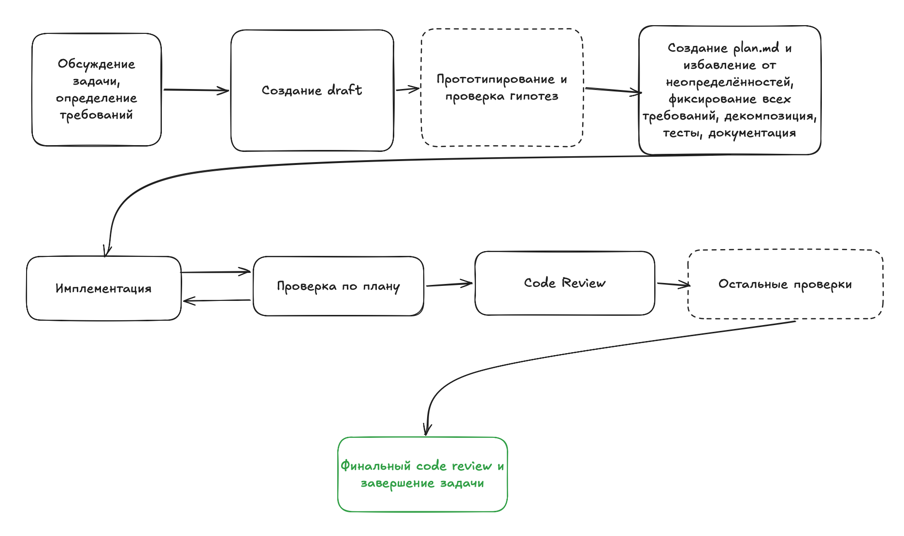

# Урок 5

Plan & Act

  
plan

  
act

  
review

  
feedback loop

  
checks

<!--
- В прошлых уроках мы говорили про skills, MCP, безопасность и AI-Native repo.
- Теперь говорим про процесс реализации задач.
- Главная идея: агенту нельзя просто сказать “сделай фичу” и надеяться, что он правильно понял весь контекст.
- Сначала нужно сформировать хороший план, а уже потом отдавать задачу в реализацию.
-->

---

# Типичный сценарий

  <section class="panel good">
    
как хочется

    
описал задачу → агент понял → сделал правильно

  </section>
  <section class="panel bad">
    
как часто бывает

    
агент понял по-своему → follow-up → переделки

  </section>

Сначала уточняем задачу и план
 
Потом пишем код

<!--
- Обычно - отправить задачу в AI и ждать результата
- В результате - идеальный сценарий - агент сразу понимает задачу
- Но часто - не понимает
- Результат юзера не устаривает и приходится исправлять косяки
- В AI coding такой подход не оптимален
- Эффективнее - планирование
- Именно про этот подход мы сейчас и поговорим.
-->

---

# Plan & Act

  
обсуждение

  
→

  
draft

  
→

  
plan

  
→

  
implementation

  
→

  
review

  
→

  
fixes

  
по плану агент реализует задачу

  
по плану другой агент проверяет результат

<!--
- Это распространённый подход к работе с AI coding agents.
- Суть не в том, чтобы написать красивый документ.
- Суть в том, чтобы создать рабочий артефакт, по которому агент сможет реализовать задачу и по которому другой агент сможет проверить результат.
-->

---

# Определяем фичу

  <section class="panel accent">
    
старт

    
Не идеальное ТЗ, а границы задачи

  </section>
  <section class="list">
    
цель фичи

    
пользовательский сценарий

    
ограничения

    
что точно не делаем

    
ожидаемый результат

  </section>

<!--
- На первом этапе мы формулируем идею
- Идеально - не обязательно
- Важно начать обсуждение и понять границы задачи
- Если задача большая, делаем draft, который будем дорабатывать
-->

---

# Обсуждаем задачу с агентом

  <section class="panel accent">
    
Research, not implementation

    
на этом этапе агент исследует, а не пишет фичу

  </section>
  <section class="grid grid-cols-2 gap-4 text-xl font-medium">
    
изучить код

    
прочитать docs

    
посмотреть в интернете

    
посмотреть в других репо

    
предложить варианты

    
сравнить trade-offs

  </section>

<!--
- Мы можем попросить агента изучить кодовую базу и понять, куда эта фича должна встроиться.
- Иногда нужно посмотреть документацию библиотек или актуальные best practices.
- Иногда полезно попросить агента предложить несколько вариантов реализации и сравнить trade-offs.
- На этом этапе мы ещё не реализуем, а исследуем задачу.
-->

---

# Draft задачи

  <section class="panel accent">
    
draft

    
Контекст больше не живёт только в чате

  </section>
  <section class="list">
    
контекст

    
цель

    
решения из обсуждения

    
вопросы

    
ограничения

    
ссылки на код и документы

  </section>

<!--
- После первичного обсуждения полезно зафиксировать всё в draft.md
- Драфт нужен, чтобы не держать контекст только в чате и чтобы у агента была возможность на что то опираться
-->

---

# Иногда нужен прототип

  
идея

  
→

  
быстрый proof of concept

  
→

  
ограничения для плана

  
API

  
UI-идея

  
интеграция

  
не финальная реализация

<!--
- На этом этапе надо понять, как задача встроится в проект.
- Можно попросить агента сделать маленький прототип для проверки гипотезы
- Результат фиксируем в драфте
-->

---

# Открытые вопросы

  <section class="panel">
    
агент может закрыть

    
код, документация, похожие места, технические ограничения

  </section>
  <section class="panel accent">
    
человек должен решить

    
продуктовые решения, бизнес-границы, спорные trade-offs

  </section>

Хороший план не прячет неопределённость

<!--
- После того как мы определились на требованиях – открытые вопросы
- На часть вопросов агент скорее всего сможет ответить сам, а на другие ответить должны мы
- Мы можем просить совета у агента
- По окончанию этого процесса у нас не должно остаться неопределённостей
-->

---

# Перекрёстное review плана

  
draft / plan из текущего чата

  
→

  
новый чат или другая модель

  
fresh context

  
открытые вопросы

  
риски

  
корректировки до реализации

<!--
- Когда draft уже собран, можно получить ещё одно непредвзятое мнение со стороны.
- На этом этапе важно создать независимость от текущего чата в котором обсуждали решение
- Для этого открываем новый чат с агентом - либо тот же агент либо другой
- Просим ознакомиться с проектом и оценить наш драфт и найти открытые вопросы, неопределённости, минусы и т. д.
-->

---

# Консилиум моделей

  
одинаковый входной контекст

  
→

  
3-5 независимых reports

  
→

  
итоговый report

  
повторяющиеся проблемы

  
уникальные находки

<!--
- Опционально – консилиум моделей
- Мы берём несколько моделей и параллельно просим каждую проверить план по одним и тем же критериям.
- На выходе получаем несколько независимых мнений
- Выделяем общие проблемы и смотрим на уникальные
- Opensource модели тут тоже пригождаются
- В моих кейсах это чаще всего избыточно, но для дорогих или рискованных изменений такой подход может быть полезен.
-->

---

# Чистовой план

  <section class="panel accent">
    
plan.md

    
По нему можно реализовать и проверить задачу

  </section>
  <section class="grid grid-cols-2 gap-4 text-lg font-medium">
    
описание задачи

    
что сделать

    
как работает

    
что используем

    
что не используем

    
ограничения

    
критерии приемки

    
план тестирования

  </section>

<!--
- Чистовик плана должен содержать детальное описание задачи и ожидаемого поведения.
- В нём нужно зафиксировать, какие подходы мы используем, а какие не используем.
- Важно закрыть открытые вопросы до передачи в реализацию.
- Ключевое - план должен быть самодостаточным.
- Все нюансы из обсуждений в текущем чате нужно отразить в плане
-->

---

# Декомпозиция задачи

  
большой plan

  
→

  
маленькие шаги

  
→

  
проще выполнить и проверить

  
порядок

  
зависимости

  
результат шага

  
оценка сложности

<!--
- Как только есть план - делаем декомпозицию
- Декомпозиция позволяет эффективнее выполнять и проверять работу
-->

---

# Критерии приемки

  <section class="panel bad">
    
плохо

    
“сделай нормально”

  </section>
  <section class="list">
    
пользователь может сделать X

    
система отвечает Y

    
ошибка отображается Z

    
старое поведение не ломается

    
edge cases описаны явно

  </section>

<!--
- Критерии приемки позволят правильно проверить результат
- По ним можно писать тесты.
- Чем конкретнее критерии, тем проще построить feedback loop.
-->

---

# План тестирования и документация

  
acceptance criteria

  
→

  
test plan

  
unit

  
integration

  
e2e / browser

  
manual

  
regression

  
edge cases

<!--
- На этом же этапе прорабатываем план тестирования
- У нас уже есть критерии приемки и по ним проще описывать тесты
- Так же на этом этапе необходимо определить, какая документация из memory bank будет обновлена
-->

---

# Implementation

  
читает план

  
→

  
изучает файлы

  
→

  
вносит changes

  
→

  
запускает checks

  
→

  
фиксирует результат

Когда план хороший, агент меньше угадывает и больше выполняет

<!--
- На этом этапе у нас уже есть план того, что нам нужно делать.
- декомпозиция, тесты, документация
- сняли когнитивную нагрузку с имплементатора, ему не нужно думать, что и как можно сделать
- имплементацию можно делегировать менее умным моделям
- я использовал gpt-5.3-codex, сейчас - gpt 5.5 medium
- можно использовать китайские open source модели
-->

---

# Проверяем реализацию по плану

  
plan

  
+

  
diff / commits / код

  
→

  
issues

  
Вопрос: “код соответствует плану?”

  
Это ещё не code review

<!--
- код написано, что дальше?
- этап проверки
- сверяем план и реализованный код.
- просим независимого агента проверить код по плану и найти ошибки если они есть
- важно - не просить делать code review – только сверку с планом
- в ответе агент должен подготовить отчёт
-->

---

# Feedback loop

  
review

  
→

  
issues

  
→

  
fixes

  
→

  
repeat review

Проверяем не только фикс, но и задачу целиком

<!--
- Если агент нашёл проблемы, мы отправляем их на доработку имплементеру
- После исправлений нужно повторить review с учётом исправлений
-->

---

# Code review

  
план: сделали ли обещанное?

  
review: хорошо ли сделано?

  
качество кода

  
архитектурные границы

  
maintainability

  
testability

  
стиль проекта

  
side effects

<!--
- теперь можно делать code review
- Проверка по плану отвечает на вопрос: “сделали ли мы то, что обещали?”
- Code review отвечает на другой вопрос: “хорошо ли это сделано?”
- Если у проекта есть критерии хорошего кода и архитектуры, агент может проверить реализацию по этим критериям.
- Найденные проблемы снова отправляются в feedback loop.
-->

---

# UI review

  
Figma / screenshot

  
→

  
browser check

  
→

  
visual issues

  
responsive

  
dark / light

  
text overflow

  
fix → repeat

<!--
- Если задача связана с версткой, можно отдельно проверить UI.
- Агент может сравнить реализацию с Figma-макетом или скриншотом.
- Если есть проблемы, они исправляются и проверка повторяется.
- Этот этап опциональный, но очень полезный для frontend-задач.
-->

---

# QA по user stories

  
user story

  
→

  
browser / API

  
→

  
bug report

  
test data

  
happy path

  
edge cases

  
feedback loop глазами пользователя

<!--
- Если в плане описан пользовательский сценарий, мы можем провести QA
- Агент может пройти flow в браузере, отправить запросы на backend, проверить состояние данных.
- Найденные проблемы снова возвращаются в доработку.
- Это тот же feedback loop, просто с точки зрения пользователя.
-->

---

# Схема процесса

  

<!--
- На этой схеме можно увидеть весь процесс целиком.
- Сначала мы формируем требования, draft и чистовой план.
- После этого отдаём задачу в реализацию.
- Затем запускаем проверки: соответствие плану, code review, UI review или QA, если они нужны.
- Все найденные проблемы возвращаются в feedback loop: issues, fixes, повторная проверка.
-->

---

# Финальный review

  
план выполнен

  
тесты проходят

  
код не разъехался

  
архитектура цела

  
docs актуальны

Последняя защита от fixes, которые создали новую проблему

<!--
- Если в процессе review и QA мы что-то исправляли, в конце стоит провести финальную проверку.
- Цель — убедиться, что после всех изменений код и архитектура проекта не разъехались.
- Это последняя защита от ситуации, когда локальные fixes создали новую проблему.
-->

---

# Дополнительные проверки

  
docs

  
memory bank

  
security

  
performance

  
observability

  
migrations

Добавляем только те проверки, которые важны конкретному проекту

<!--
- Мы не ограничивается одним review.
- В зависимости от проекта можно добавить проверку документации, безопасности, производительности и т. д.
- Важно, чтобы эти проверки были явно описаны и могли повторяться.
-->

---

# Роль человека

  
начало: что хотим получить

  
↔

  
конец: принять результат

  
требования

  
продуктовые решения

  
открытые вопросы

  
приёмка

  
ручная проверка

<!--
- Ключевая особенность подхода в том, что многие этапы можно делать автономно.
- Но человек всё ещё нужен в самом начале на определении shape и требований
- И в конце, когда нужно принять результат или проверить то, что нельзя полностью доверить агенту.
-->

---

# Что можно автоматизировать

  
понятный plan

  
→

  
повторяемый workflow

  
implementation

  
plan review

  
code review

  
fixes

  
UI review

  
QA

  
final review

<!--
- Почти все этапы после постановки требований можно автоматизировать.
- Для этого нужен понятный входной артефакт: plan.
- И нужны повторяемые проверки, которые агент умеет запускать.
- В этом уроке мы пройдём процесс вручную, чтобы понять механику.
- На следующем поговорим про создание автоматизации
-->

---

# Готовые фреймворки

Это разные автоматизации одного базового паттерна

  
OpenSpec

  
Spec Kit

  
GSD

  
BMAD

  
Superpowers

  
Codex /goal

  
Ralph loop

  
requirements

  
→

  
plan

  
→

  
implementation

  
→

  
review

<!--
- Всё, что мы сейчас описали вручную, уже пытаются упаковать в готовые фреймворки и workflows.
- У них общий корень: сначала требования и план, потом реализация, потом проверка результата.
- Отличаются они тем, где делают акцент: на требованиях, ролях, автономном исполнении, skills, fresh context или долгом loop.
-->

---

# OpenSpec

  <section class="panel">
    
как работает

    

      
01 описываем изменение

      
02 уточняем требования

      
03 реализуем

      
04 сверяем результат

    

  </section>
  <section class="grid gap-4">
    
Хвалят: легче больших комбайнов, можно встроить в existing project

    
Критикуют: слабее technical plan, много текста и токенов

    
Не заменяет полноценную memory проекта

  </section>

<!--
- В OpenSpec сначала мы описываем, что именно должно измениться и зачем.
- Потом агент помогает уточнить требования и только после этого переходит к реализации.
- Его плюс в том, что он хорошо закрывает бизнес-требования и помогает не потерять смысл изменения.
- Но техническая часть может быть слабой: часто это список задач, а не полноценный implementation plan.
- Ещё одна проблема — overhead: много spec-артефактов, много проходов через агента, много токенов.
- И OpenSpec сам по себе не заменяет техническую базу знаний о проекте: архитектуру и причины решений всё равно нужно вести отдельно.
-->

---

# Spec Kit

  <section class="panel">
    
как работает

    

      
01 принципы проекта

      
02 описание фичи

      
03 technical plan

      
04 задачи и реализация

    

  </section>
  <section class="grid gap-4">
    
Хвалят: строгая структура и меньше хаоса

    
Лучше подходит для больших feature-workflows

    
Критикуют: много ceremony, docs и babysitting между фазами

  </section>

<!--
- Spec Kit сначала фиксируются принципы проекта: качество, тесты, UX, ограничения, архитектурные ожидания.
- Потом фича проходит через уточнение требований, технический план и декомпозицию на задачи.
- Это полезно, когда задача большая и нужно заранее поймать продуктовые и архитектурные решения.
- Но цена — бюрократия.
- Маленькая фича может быстро превратиться в гору документов.
- На реальных длинных проектах specs могут drift-иться, и тогда приходится поддерживать документы почти как отдельный продукт.
-->

---

# GSD

  <section class="panel">
    
как работает

    

      
01 изучает проект

      
02 задаёт вопросы

      
03 строит план

      
04 запускает агентов и verify

    

  </section>
  <section class="grid gap-4">
    
Хвалят: fresh context и хорошие вопросы в начале

    
Критикуют: токены, subagents, раздутые задачи

    
Боль: слабая живая база знаний проекта

  </section>

<!--
- GSD пытается организовать длинную работу: собрать контекст, обсудить серые зоны, распланировать фазу, запустить агентов и потом проверить результат.
- В начале это может сильно помогать, потому что фреймворк задаёт вопросы, о которых человек не подумал.
- Но отзывы показывают и обратную сторону: процесс может искусственно раздувать даже простые задачи.
- Subagents и повторные проверки быстро сжигают токены.
- Появляется много markdown-документов, которые сложно реально вычитать.
- И если проект становится сложнее, начинает мешать отсутствие живой базы знаний: артефакты есть, но они не всегда превращаются в понятную память об архитектуре и решениях.
- GSD соскамился
-->

---

# BMAD

  <section class="panel">
    
как работает

    

      
01 бизнес-контекст

      
02 требования

      
03 архитектура и stories

      
04 разработка и QA

    

  </section>
  <section class="grid gap-4">
    
Хвалят: закрывает продукт, архитектуру, реализацию и review

    
Силен для проекта с нуля

    
Критикуют: тяжёлый ролевой комбайн и высокая ceremony

  </section>

<!--
- BMAD можно объяснить как ролевой процесс.
- Там есть условные роли: продукт, аналитик, архитектор, разработчик, QA.
- Сначала собирается бизнес-контекст и требования.
- Потом отдельно прорабатывается архитектура и stories для разработки.
- После этого агент пишет код, а финальный слой проверяет результат.
- Плюс BMAD в полноте: для проекта с нуля он может закрыть весь путь от идеи до реализации.
- Минус — вес процесса. Нужно отвечать на много вопросов, читать много промежуточных материалов, и для инженера это может быть лишней ceremony.
-->

---

# Superpowers

  <section class="panel">
    
как работает

    

      
01 brainstorming

      
02 план

      
03 маленькие шаги

      
04 review

    

  </section>
  <section class="grid gap-4">
    
Хвалят: дисциплина, TDD, отдельный review

    
Критикуют: душность, token burn, лишние варианты и документы

    
Риск: skills не всегда срабатывают в нужный момент

  </section>

<!--
- В Superpowers работает так
- Агент сначала обсуждает идею, предлагает варианты, пишет план, а потом реализует его маленькими шагами.
- В хороших сценариях это добавляет дисциплину: не кодить сразу, сначала понять задачу и согласовать направление.
- Но многие критикуют Superpowers за душность.
- Он может задавать слишком много вопросов, генерировать лишние варианты и создавать документы, которые никто не будет читать.
- Также skill-based workflow работает только если skills реально срабатывают в нужный момент.
- Иначе это превращается в красивую методологию, которая не всегда влияет на поведение агента.
-->

---

# Codex `/goal`

  
clear goal

  
→

  
iteration

  
→

  
evidence check

  
bug hunt

  
migrations

  
без clear done condition loop ходит кругами

<!--
- помимо этих фреймворков, есть ещё и встроенная фича от codex - `/goal`
- Он полезен, когда у нас уже есть понятный финиш: тесты зелёные, grep ничего не находит, benchmark достиг нужного значения.
- Тогда Codex может работать не одним ответом, а несколькими итерациями.
- После каждой итерации он проверяет evidence и решает, продолжать или завершать.
- Это удобно для задач с ясной метрикой готовности.
- Но если цель расплывчатая, loop может начать ходить кругами или добавлять лишний код.
- Поэтому `/goal` усиливает Plan & Act, но не отменяет хороший план.
-->

---

# Ralph loop

  
state в файлах

  
→

  
fresh context

  
→

  
следующая итерация

  
борется с context rot

  
подходит для long-running work

  
не спасает слабый план

<!--
- Ralph loop — это подход, где состояние задачи хранится не в истории чата, а в файлах проекта.
- Каждая итерация запускает агента заново со свежим контекстом.
- Агент берёт следующую задачу, реализует её, запускает проверки и обновляет progress.
- Главный плюс — борьба с context rot на длинных задачах.
- Но сам loop не делает работу умнее.
- Если план слабый, агент просто будет быстрее повторять ошибки.
- Поэтому Ralph loop полезен только поверх хорошей декомпозиции, тестов, progress tracking и понятного stop condition.
-->

---

# Как выбирать подход

  <section class="panel accent">
    
Overhead должен окупаться контролем

  </section>
  <section class="grid grid-cols-2 gap-4 text-lg font-medium">
    
small task → plan mode

    
big feature → draft → plan → review

    
critical task → cross-review

    
long-running → /goal или Ralph loop

    
greenfield → BMAD / GSD

    
existing project → lightweight workflow

  </section>

<!--
- Главный вывод не в том, что нужно срочно выбрать один фреймворк.
- Скорее наоборот: сначала нужно понять базовый ручной процесс.
- Для маленькой задачи тяжёлый SDD-фреймворк часто не нужен.
- Для большой задачи уже полезны draft, план, acceptance criteria и отдельный review.
- Для long-running задач можно добавить `/goal` или Ralph loop.
- Для сложного greenfield можно смотреть на BMAD или GSD, но нужно понимать цену в токенах, документах и контроле.
- И почти всегда хорошая инженерная декомпозиция остаётся важнее, чем название фреймворка.
-->

---

# Что дальше

Сначала вручную
 
Потом — skill

  
понять шаги

  
→

  
описать workflow

  
→

  
упаковать в skill

  
→

  
повторять автономно

<!--
- На текущем уроке мы разберём этот процесс в ручном режиме.
- Это нужно, чтобы понять, из каких шагов он состоит и где появляются feedback loops.
- На следующем уроке мы составим skill для этого процесса и сделаем его более автономным.
-->
